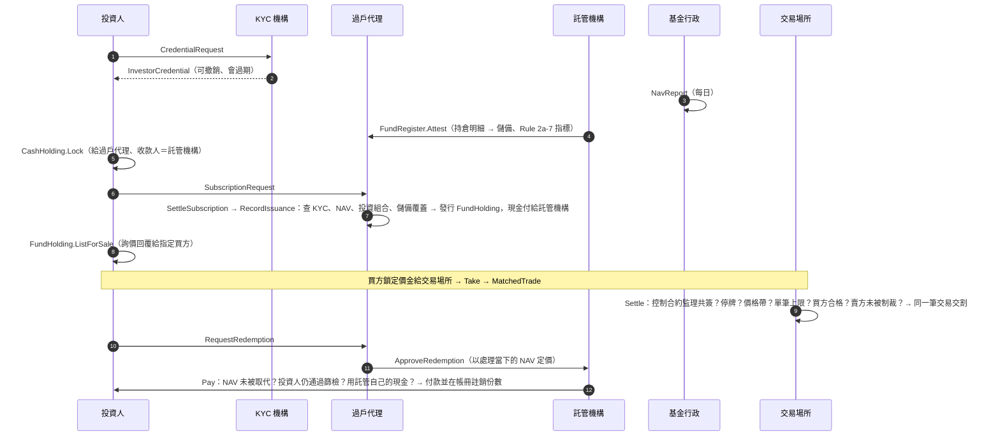

# ZuecanRWAton：Canton／Daml 上的代幣化貨幣市場基金

ZuecanRWAton 是一個寫在 **Canton 帳本（Daml 3.4）** 上的真實資產（RWA）代幣化平台原型。
標的是**代幣化政府貨幣市場基金**（持有美國短期公債與公債附買回）。平台涵蓋發行端（申購、贖回、儲備證明、過戶代理）與**許可制次級市場**（詢價＋款券同步交割）。

> **不是法律意見，也不是投資建議。** 這是研究與教學用的原型：託管機構、基金行政、KYC 機構、穩定幣發行人在測試裡都由帳本上的角色模擬，沒有任何真實資產或真實資金。
> 正式的模型規格見 [`docs/SPECIFICATION.md`](docs/SPECIFICATION.md)。
> 監理定位一律需要法遵確認，詳見 [`docs/COMPLIANCE_MAPPING.md`](docs/COMPLIANCE_MAPPING.md) 與 [`docs/LIMITATIONS.md`](docs/LIMITATIONS.md)。

---

## 為什麼說它是「真實 RWA」，而不是合成資產

這個 repo 是從 [PepeLab On-Chain CFD](https://github.com/zuemen/pepelab_onchain_cfd) 的檢討出發的：PepeLab 的 sAAPL 等是**參照 RWA 價格的合成衍生品**。
判斷「真實 RWA 代幣化」有三個問題，PepeLab 三題都答「否」；本平台把每一題都寫成帳本規則：

| 檢驗 | PepeLab（合成） | ZuecanRWAton（代幣化） | 在哪裡強制 |
|---|---|---|---|
| 鏈下有沒有真的資產？ | 沒有；只有價格 | 託管機構逐筆申報基金持倉（證券代號、面額、市值、到期日），儲備＝持倉市值總和；申報與違規項目上鏈公開 | `FundRegister.Attest`、`ReserveAttestation` |
| 代幣數量對不對得上資產？ | 不足額抵押（AssetVault 自述） | **任何一筆發行都要通過「流通份數 × NAV ≤ 已證明儲備＋聲明後的鏈上淨流入」**；聲明過期就不能發行。發行只能由帳冊執行：要投資人授權、消耗投資人真的鎖定的現金、份數由帳冊按 NAV 計算。每份份數都要託管機構共簽，**帳冊之外不可能出現份數** | `FundRegister.RecordIssuance` |
| 持有人有沒有權利？ | 沒有 | 持有部位由**過戶代理、託管機構與持有人三方簽署**；任何轉出、凍結、扣押都只能走持有人簽署時就同意的 choice，並留下紀錄 | `Zuecan.Registry` |

此外：
- **合格投資人**：申購、受讓、成交（份數交到新的持有人）都要出示 KYC 機構簽發、未過期、制裁篩檢未逾 90 天的憑證，而且投資人類別與法域要在基金條款允許清單內。撤銷憑證會立刻生效。付款給投資人之前（成交價金、贖回款），以及轉出份數之前，都會重新檢查制裁篩檢。
- **儲備不足時的處理**：託管聲明低於負債時，新申購與以舊 NAV 贖回**都會被拒**（避免先跑的人佔便宜）。要等基金行政重新計算 NAV 才能恢復。
- **貨幣基金投資限制（Rule 2a-7）**：帳本由申報的持倉計算 WAM、WAL、最長到期、每日／每週流動資產與政府資產占比；任一項違規就停止新申購（贖回照常），違規內容公開。
- **監理機關**：以 observer 身分看得到所有持有部位、託管聲明、成交雙方與執法紀錄，而且可以下令停牌；監理停牌只有監理機關能解除。基金條款與交易場所的控制合約都由監理機關共同簽署：條款修訂要監理核准，交易場所只能收緊、不能放寬自己的限制。
- **執法**：過戶代理可依法律命令凍結、扣押持有部位，也能把託管中的份數（轉讓、賣單、成交、贖回）召回成凍結的部位。
- **一定有出口**：現金鎖定到期回到持有人；交易場所逾期未交割，買賣雙方都可中止；託管機構逾期未付贖回款，投資人可取回份數。
- **公開資訊**：帳冊總量、NAV、儲備聲明歷史、成交的價格與數量對 `Public` 角色公開，**不含**交易雙方身分。

## 角色

| 角色 | 在帳本上做什麼 | 正式環境的對應 |
|---|---|---|
| `TransferAgent`（過戶代理／登記機構） | 提案基金條款；簽署持有部位；處理申購贖回；凍結、扣押、召回 | 基金的 transfer agent |
| `Custodian`（託管機構） | 與過戶代理共同簽署帳冊與每一份持有部位；逐筆申報持倉；支付贖回款 | 保管銀行 |
| `FundAdministrator`（基金行政） | 每日計算並公布 NAV | fund administrator |
| `KycAgent`（KYC 機構） | 簽發、重新篩檢、撤銷投資人憑證 | 持牌的 KYC／AML 服務商 |
| `VenueOperator`（交易場所） | 款券同步交割；停牌；收緊價格帶與單筆上限（放寬需監理） | 受監理的代幣化證券交易場所 |
| `Regulator`（監理機關） | 全部看得到；核准條款與交易場所；下令停牌與解除 | SEC／金管會 |
| `UsdIssuer`（穩定幣發行人） | 發行結算用美元代幣 | GENIUS 法案下的支付型穩定幣（例如 Canton 上的 USDC） |
| `Public` | 唯讀公開資訊 | 任何人都可以 `readAs` 的公開 party |

## 流程



## 執行

需要 Docker。Daml SDK 3.4 的穩定版只能用 Digital Asset 的 `dpm` 安裝，所以本 repo 固定使用 Docker Hub 上的官方映像（CI 以 digest 鎖定）。

```bash
scripts/daml-test.sh      # IDE ledger：全部情境＋覆蓋率門檻（約 30 秒）
scripts/canton-test.sh    # 真正的 Canton participant：起 sandbox、上傳 DAR、依序跑全部情境（約 10 分鐘）
scripts/mutation_test.py  # 突變測試（約 20 分鐘，3 路平行）
scripts/app-test.sh       # JSON Ledger API 應用：在 Canton sandbox 上跑完整業務流程，產生監理檢視頁（約 2 分鐘）
```

- `main/`：上帳本的合約（package `zuecan-rwa`）。**不依賴 daml-script**，可以上傳到 Canton participant，之後用 Smart Contract Upgrade 升級。
- `test/`：Daml Script 情境測試（package `zuecan-rwa-test`），目前 37 個情境。
  - CI 會擋下有任何 choice（內建 Archive 除外）沒被執行、或任何 template 沒被建立過的變更。
  - `Test.Adversarial`：一次獨立對抗式審查找到的 7 項攻擊（F1–F7），每一項一個回歸情境（見 [`docs/SPECIFICATION.md`](docs/SPECIFICATION.md) 10.5）。
  - `Test.Canton:allScenarios` 依序跑完全部情境，供 Canton 實跑使用。
  - `Test.Setup:demo` 是 `daml start` 的示範資料。
- **Canton 實跑**：同一批情境不只在模擬帳本（IDE ledger）上跑，也透過 Ledger API 在真正的 Canton sandbox participant（靜態時間）上跑，CI 每次都執行。
- 每個失敗情境都用 `expectFailure` 比對錯誤訊息，確認是被**預期的那條規則**擋下。移動份數的 31 個情境結尾都跑 `checkReconciles`，確認監理機關看得到的所有份數（含託管中的）等於帳冊流通量。
- 突變測試：逐一拿掉 80 條關鍵檢查、計算或授權，每一條都至少讓一個測試失敗（結果見 [`docs/ARCHITECTURE.md`](docs/ARCHITECTURE.md#測試與突變測試)）。

## 應用程式：透過 JSON Ledger API 操作帳本

`app/` 是一個不依賴任何 npm 套件的 TypeScript 程式（Node 22 直接執行），透過 Canton 的 **JSON Ledger API v2** 操作帳本，等於一個最小的後端：

- `src/ledger.ts`：JSON Ledger API 用戶端（配置 party、送交易並等結果、查 active contract set）。
- `src/zuecan.ts`：業務操作，一個函式對應一個業務步驟。包括發行基金（過戶代理提案、監理核准條款）、投資人開戶、申購、託管機構申報、在交易場所交割，以及贖回。
- `src/flow.ts`：端到端流程，跑完後以監理機關的視角對帳並檢查 9 個條件：帳實相符、儲備足額、無投資組合違規、公眾看不到持有人與成交身分等。
- `src/report.ts`：**監理檢視頁**（`app/out/regulator.html`），內容包括流通份數、NAV、覆蓋率、儲備聲明歷史與 Rule 2a-7 指標、持有人、成交。CI 每次都會產生，並保存為 artifact。

```bash
scripts/app-test.sh   # 起一個 wall-clock 的 Canton sandbox，上傳 DAR，跑 app/src/flow.ts
```

## 目錄

```
main/daml/Zuecan/
  Types.daml          共用型別與數值工具（6 位小數無條件捨去）
  Compliance.daml     KYC 憑證：申請、核發、重新篩檢、撤銷；資格檢查
  Cash.daml           結算現金與託管鎖定（只能付給約定收款人、逾期由持有人取回）
  Fund.daml           基金條款、NAV
  Portfolio.daml      持倉與 Rule 2a-7 指標（WAM、WAL、最長到期、流動資產、政府資產占比）
  Registry.daml       帳冊（雙簽、儲備覆蓋、發行與註銷）、持有部位與所有移動方式：轉讓、詢價成交、贖回、凍結、扣押、召回
  Market.daml         交易場所控制（監理共簽；停牌、價格帶、單筆上限）、成交公告與監理申報
  Subscription.daml   申購
test/daml/Test/
  Setup.daml          測試世界與共用工具
  Primary.daml        發行端情境
  Secondary.daml      次級市場與執法情境
  Portfolio.daml      持倉申報與投資組合限制
  Controls.daml       單方不得改帳、帳冊外不得出現份數、雜項
  Adversarial.daml    獨立審查找到的攻擊（F1–F7）的回歸測試
  Canton.daml         依序執行全部情境（Canton 實跑用）
app/                  JSON Ledger API 應用（後端操作、端到端流程、監理檢視頁）
docs/
  SPECIFICATION.md    帳本模型規格書：定義、授權語意、操作前後置條件、計算公式、不變式、驗證證據（附錄 C 由原始碼產生）
  ARCHITECTURE.md     設計、授權與隱私矩陣、不變式、取捨
  COMPLIANCE_MAPPING.md  SEC 創新豁免、Rule 2a-7、台灣規範對照
  LIMITATIONS.md      已知限制與未查證事項
```

## 路線圖

已完成：
- ~~在真正的 Canton participant 上跑~~：`scripts/canton-test.sh`，CI 每次執行。
- ~~儲備聲明細項與 Rule 2a-7 限制~~：`Zuecan.Portfolio`。
- ~~基金條款監理共簽~~：`TermsProposal`。
- ~~透過 JSON Ledger API 的後端與監理檢視頁~~：`app/`。
- ~~獨立對抗式審查~~：7 項攻擊全部修正，各有回歸情境與突變測試。

接下來：
1. **Canton Network LocalNet**：用 Splice LocalNet（含 synchronizer 與多個 participant）跑同樣的流程，讓每個角色各自在不同節點。
2. **對接 Canton Network 代幣標準**（CIP-0056，細節未查證），讓持有部位可以被錢包與其他應用辨識。
3. **真實結算資產**：以 Canton 上的受監管穩定幣取代 `UsdIssuer` 替身。
4. **前端**：投資人入口、過戶代理後台（後端操作與監理檢視頁已有，見上方「應用程式」）。正式環境還需要 JWT 驗證與每個角色各自的使用者權限。
