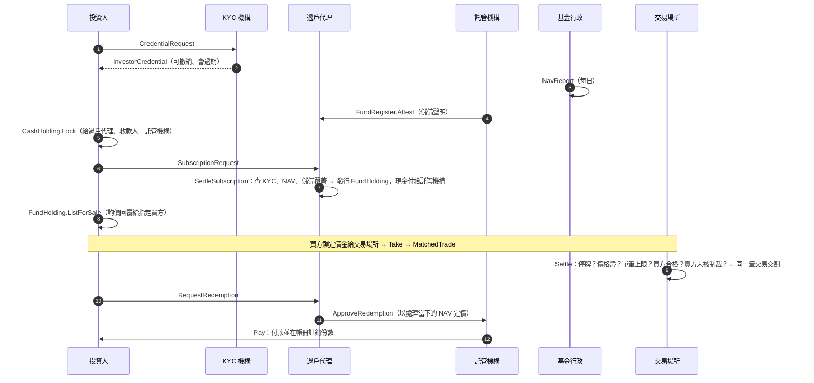

# ZuecanRWAton：Canton／Daml 上的代幣化貨幣市場基金

ZuecanRWAton 是一個寫在 **Canton 帳本（Daml 3.4）** 上的真實資產（RWA）代幣化平台原型。
標的是**代幣化政府貨幣市場基金**（持有美國短期公債與公債附買回）。平台涵蓋發行端（申購、贖回、儲備證明、過戶代理）與**許可制次級市場**（詢價＋款券同步交割）。

> **不是法律意見，也不是投資建議。** 這是研究與教學用的原型：託管機構、基金行政、KYC 機構、穩定幣發行人在測試裡都由帳本上的角色模擬，沒有任何真實資產或真實資金。
> 監理定位一律需要法遵確認，詳見 [`docs/COMPLIANCE_MAPPING.md`](docs/COMPLIANCE_MAPPING.md) 與 [`docs/LIMITATIONS.md`](docs/LIMITATIONS.md)。

---

## 為什麼說它是「真實 RWA」，而不是合成資產

這個 repo 是從 [PepeLab On-Chain CFD](https://github.com/zuemen/pepelab_onchain_cfd) 的檢討出發的：PepeLab 的 sAAPL 等是**參照 RWA 價格的合成衍生品**。
判斷「真實 RWA 代幣化」有三個問題，PepeLab 三題都答「否」；本平台把每一題都寫成帳本規則：

| 檢驗 | PepeLab（合成） | ZuecanRWAton（代幣化） | 在哪裡強制 |
|---|---|---|---|
| 鏈下有沒有真的資產？ | 沒有；只有價格 | 託管機構對基金資產出具聲明，聲明本身上鏈並公開 | `FundRegister.Attest`、`ReserveAttestation` |
| 代幣數量對不對得上資產？ | 不足額抵押（AssetVault 自述） | **任何一筆發行都要通過「流通份數 × NAV ≤ 已證明儲備＋聲明後的鏈上淨流入」**；聲明過期就不能發行。發行只能由帳冊執行：要投資人授權、消耗投資人真的鎖定的現金、份數由帳冊按 NAV 計算 | `FundRegister.RecordIssuance` |
| 持有人有沒有權利？ | 沒有 | 持有部位由**過戶代理與持有人雙簽**；任何轉出、凍結、扣押都只能走持有人簽署時就同意的 choice，並留下紀錄 | `Zuecan.Holding` |

此外：
- **合格投資人**：申購、受讓、成交都要出示 KYC 機構簽發、未過期、制裁篩檢未逾 90 天的憑證，而且投資人類別與法域要在基金條款允許清單內。撤銷憑證會立刻生效。
- **儲備不足時的處理**：託管聲明低於負債時，新申購與以舊 NAV 贖回**都會被拒**（避免先跑的人佔便宜）。要等基金行政重新計算 NAV 才能恢復。
- **監理機關**：以 observer 身分看得到所有持有部位、託管聲明、成交雙方與執法紀錄，而且可以下令停牌；監理停牌只有監理機關能解除。
- **公開資訊**：帳冊總量、NAV、儲備聲明歷史、成交的價格與數量對 `Public` 角色公開，**不含**交易雙方身分。

## 角色

| 角色 | 在帳本上做什麼 | 正式環境的對應 |
|---|---|---|
| `TransferAgent`（過戶代理／登記機構） | 簽署基金條款、持有部位；處理申購贖回；凍結、扣押 | 基金的 transfer agent |
| `Custodian`（託管機構） | 與過戶代理共同簽署帳冊；出具儲備聲明；支付贖回款 | 保管銀行 |
| `FundAdministrator`（基金行政） | 每日計算並公布 NAV | fund administrator |
| `KycAgent`（KYC 機構） | 簽發、重新篩檢、撤銷投資人憑證 | 持牌的 KYC／AML 服務商 |
| `VenueOperator`（交易場所） | 款券同步交割；停牌；價格帶與單筆上限 | 受監理的代幣化證券交易場所 |
| `Regulator`（監理機關） | 全部看得到；下令停牌與解除 | SEC／金管會 |
| `UsdIssuer`（穩定幣發行人） | 發行結算用美元代幣 | GENIUS 法案下的支付型穩定幣（例如 Canton 上的 USDC） |
| `Public` | 唯讀公開資訊 | 任何人都可以 `readAs` 的公開 party |

## 流程



## 執行

需要 Docker。Daml SDK 3.4 的穩定版只能用 Digital Asset 的 `dpm` 安裝，所以本 repo 固定使用 Docker Hub 上的官方映像（CI 以 digest 鎖定）：

```bash
docker run --rm -v "$PWD:/w" -w /w digitalasset/daml-sdk:3.4.0-rc2 \
  sh -c 'daml build --all && cd test && daml test --show-coverage --all'
```

- `main/`：上帳本的合約（package `zuecan-rwa`）。**不依賴 daml-script**，可以上傳到 Canton participant，之後用 Smart Contract Upgrade 升級。
- `test/`：Daml Script 情境測試（package `zuecan-rwa-test`），目前 25 個情境，另有 4 個共用的 setup 腳本；`Test.Setup:demo` 是 `daml start` 的示範資料。CI 會擋下「有任何 choice（內建 Archive 除外）沒被測試執行到」的變更。
- 每個失敗情境都用 `expectFailure` 比對錯誤訊息，確認是被**預期的那條規則**擋下；大部分情境結尾都跑 `checkReconciles`，確認監理機關看得到的所有份數（含託管中的）等於帳冊流通量。
- 突變測試：逐一拿掉 46 條關鍵檢查或授權，確認每一條都至少讓一個測試失敗（結果見 [`docs/ARCHITECTURE.md`](docs/ARCHITECTURE.md#測試與突變測試)）。

## 目錄

```
main/daml/Zuecan/
  Types.daml          共用型別與數值工具（6 位小數無條件捨去）
  Compliance.daml     KYC 憑證：申請、核發、重新篩檢、撤銷；資格檢查
  Cash.daml           結算現金與託管鎖定（只能付給約定收款人、逾期由持有人取回）
  Fund.daml           基金條款、NAV、雙簽帳冊（儲備覆蓋檢查）、儲備聲明
  Market.daml         交易場所控制（停牌、價格帶、單筆上限）、成交公告與監理申報
  Holding.daml        持有部位與所有移動方式：轉讓、詢價成交、贖回、凍結、扣押
  Subscription.daml   申購
test/daml/Test/
  Setup.daml          測試世界與共用工具
  Primary.daml        發行端情境
  Secondary.daml      次級市場與執法情境
  Controls.daml       單方不得改帳、雜項
docs/
  ARCHITECTURE.md     設計、授權與隱私矩陣、不變式、取捨
  COMPLIANCE_MAPPING.md  SEC 創新豁免、Rule 2a-7、台灣規範對照
  LIMITATIONS.md      已知限制與未查證事項
```

## 路線圖

1. **Canton LocalNet**：用 Splice LocalNet 起 participant，透過 JSON Ledger API 跑同樣的流程。
2. **對接 Canton Network 代幣標準**（CIP-0056，細節未查證），讓持有部位可以被錢包與其他應用辨識。
3. **真實結算資產**：以 Canton 上的受監管穩定幣取代 `UsdIssuer` 替身。
4. **儲備聲明細項**：聲明附上持倉明細（CUSIP、面額、到期日），在帳本上檢查政府 MMF 的投資組合限制（WAM ≤ 60 天、WAL ≤ 120 天、單筆到期 ≤ 397 天）。
5. **前端與後端**：投資人入口、過戶代理後台、監理檢視頁。
