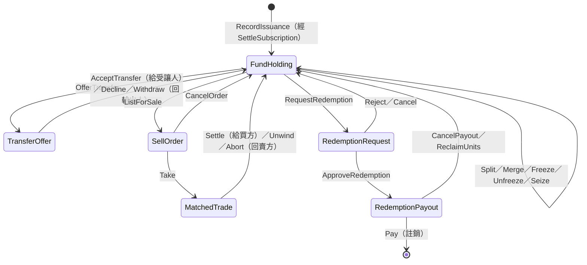
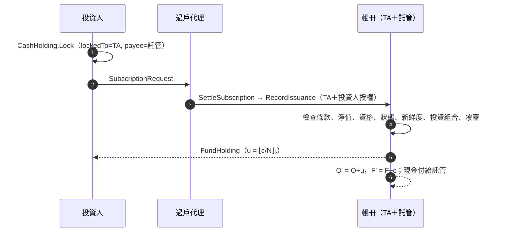
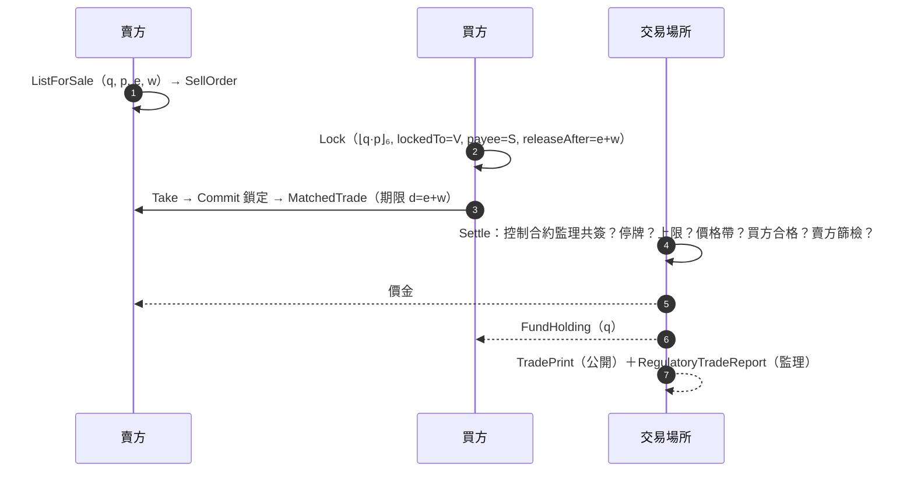

# ZuecanRWAton 帳本模型規格書

| 項目 | 內容 |
|---|---|
| 文件 | 帳本模型規格書（Ledger Model Specification） |
| 版本 | 1.1 |
| 日期 | 2026-10-12 |
| 適用程式碼 | `main/`（package `zuecan-rwa` 0.1.0），Daml SDK 3.4.0-rc2，Canton 3.4 |
| 狀態 | 研究原型。不是法律意見，也不是投資建議 |
| 驗證證據 | 第 10 章；可用 `scripts/daml-test.sh`、`scripts/canton-test.sh`、`scripts/app-test.sh`、`scripts/mutation_test.py` 重現 |
| 修訂紀錄 | 1.0：初版。1.1：修正獨立審查發現的 7 項攻擊（10.5），並依規格稽核逐條校正第 2–9 章的敘述 |

## 摘要

本文件規格化一個建在 Canton 帳本上的**代幣化政府貨幣市場基金**。基金份數的唯一來源是一本由過戶代理與託管機構共同簽署的帳冊。每一次發行都必須同時滿足四件事：

1. 申購人的授權；
2. 申購人真實鎖定的現金，在同一筆交易中被消耗，所以只能計入一次；
3. 由帳冊依當下淨值計算份數，呼叫者不能指定；
4. 發行後「流通份數 × 淨值 ≤ 託管機構逐筆申報的持倉市值 + 申報後的鏈上淨流入」。

此外：

- 每一份份數合約都需要過戶代理、託管機構與持有人三方簽署。因此除非過戶代理與託管機構串通，帳冊之外不會出現份數。
- 份數交到**新的持有人**之前，都檢查其 KYC 資格（申購、轉讓、成交）。付款給投資人之前，都重新檢查制裁篩檢（成交價金、贖回款）。執法與退回原持有人的路徑是例外，見 INV-4。
- 次級市場採詢價與款券同步交割。交易場所的控制合約由監理機關共同簽署：交易場所不能自行換掉停牌中的控制合約，也只能收緊、不能放寬自己的限制。
- 監理機關共同簽署基金條款，可以下令停牌，並看得到所有持有部位與成交雙方。
- 每一份託管中的資產都有出口：現金鎖定到期回到持有人，逾期未交割的成交、逾期未付款的贖回都可由投資人取回；託管中的份數也都可依法律命令召回並凍結。

本文第 4 章定義帳本的授權語意，第 6 章規格化每一個業務操作的前置與後置條件，第 7 章給出所有計算公式，第 8 章列出模型保證的不變式及其強制方式，第 10 章給出驗證證據。驗證包括：

- 37 個情境測試，在模擬帳本與真正的 Canton participant 上都通過；
- 透過 JSON Ledger API 的端到端流程；
- 75 個突變，每一個都被測試抓到；
- 一次獨立的對抗式審查：它以可執行的情境證明了 7 項攻擊，全部已修正並各有一個回歸情境（10.5）。

---

## 1. 範圍

### 1.1 涵蓋

- 基金設立：條款、淨值（NAV）、帳冊、交易場所。
- 投資人准入：KYC 憑證的申請、核發、重新篩檢、撤銷。
- 初級市場：申購、贖回。
- 儲備證明：託管機構逐筆申報持倉，以及 Rule 2a-7 投資組合限制。
- 次級市場：詢價、款券同步交割（DvP）、場外轉讓。
- 交易場所與監理控制：停牌、價格帶、單筆上限、公開成交資訊。
- 執法：凍結、解凍、扣押，以及召回託管中的份數。
- 條款修訂。

### 1.2 不涵蓋

- 鏈下的法律結構：基金實體、公開說明書、投資人契約。
- 實際的身分審查與制裁名單比對，由 KYC 機構在鏈下完成。
- 持倉的價格來源與淨值計算方法。
- 結算穩定幣本身的發行與贖回。
- 前端。

### 1.3 規範用語

「**必須**」表示模型以帳本規則強制；違反時交易被拒，整筆交易不生效。「**不得**」同理。「**應**」表示模型外的營運要求，帳本不強制。

### 1.4 記號

| 記號 | 意義 |
|---|---|
| $t$ | 交易的帳本時間（ledger time） |
| $\lfloor x \rfloor_6$ | 將非負數 $x$ 無條件捨去到小數 6 位 |
| $O$ | 帳冊上的流通份數（`outstanding`） |
| $R$ | 最近一次儲備聲明的持倉市值總和（`attestedReserve`） |
| $F$ | 該次聲明之後的鏈上現金淨流入（`netFlowSinceAttestation`） |
| $N$ | 當下有效的每份淨值（`navPerUnit`） |
| $\mathcal{H}$ | 該基金所有有效的持有部位（`FundHolding`） |
| $\mathcal{E}$ | 該基金所有有效的份數託管合約（`TransferOffer`、`SellOrder`、`MatchedTrade`、`RedemptionRequest`、`RedemptionPayout`） |
| $\mathrm{sig}(c)$、$\mathrm{obs}(c)$ | 合約 $c$ 的 signatory 集合、observer 集合 |

---

## 2. 術語與定義

**D1 工具（instrument）**：由 `InstrumentId { registrar, symbol }` 識別。`registrar` 是登記機構，對基金份數而言即過戶代理。

**D2 份數合約**：所有記載份數的合約，即 $\mathcal{H} \cup \mathcal{E}$。

- `FundHolding` 的 `ensure` 要求 `units` 大於 0，且等於 $\lfloor \text{units} \rfloor_6$。
- 託管合約沒有自己的 `ensure`。它們的份數一律由 `carveOut` 從持有部位切出，`carveOut` 檢查同樣兩個條件，因此託管合約的份數也滿足它們。

**D3 帳冊（register）**：`FundRegister`，記載 $O$、$R$、$F$、聲明時間、聲明序號、投資組合違規項目與基金狀態。每檔基金**應**只有一份有效帳冊；帳本不強制這一點（沒有 contract key，見 A6），限制見第 12 章。

**D4 儲備聲明**：託管機構執行 `Attest`，申報持倉清單 $P$。帳冊將 $R$ 設為 $\sum_{p \in P} \text{marketValue}(p)$，並將 $F$ 歸零；同時建立一份公開的 `ReserveAttestation` 紀錄。

**D5 負債與支撐**：負債 $L = O \times N$；支撐 $B = R + F$。

**D6 新鮮**：時間戳 $t_x$ 在最大年齡 $a$ 下為新鮮，當且僅當 $t_x \le t$ 且 $t - t_x \le a$。

**D7 篩檢合格（screened）**：憑證 $k$ 對投資人 $i$ 在 $t$ 時篩檢合格，當且僅當四項都成立：
- $k$ 屬於 $i$；
- $k$ 由該基金條款指定的 KYC 機構簽發；
- $t < k.\text{expiresAt}$；
- $k.\text{screenedAt}$ 在 `maxScreeningAge` 下為新鮮。

**D8 資格合格（eligible）**：篩檢合格，且 $k.\text{investorClass}$ 與 $k.\text{jurisdiction}$ 都在基金條款的允許清單內。

**D9 現金鎖定**：`LockedCash { owner, lockedTo, payee, releaseAfter, committed }`，signatory 只有穩定幣發行人。

| 動作 | 授權 | 時間條件 | 結果 |
|---|---|---|---|
| `PayOut` | `lockedTo` 與 `owner` 共同 | $t < \text{releaseAfter}$ | 付給 `payee` |
| `Release` | `lockedTo` | 無 | 退回 `owner` |
| `Reclaim` | `owner` | $t \ge \text{releaseAfter}$ | 退回 `owner` |
| `Commit` | `owner` | 無 | 標記為已承諾給一筆成交；已承諾者不得再承諾 |

發行人身為唯一 signatory，可以直接封存鎖定的現金。這與法幣支撐穩定幣發行人的凍結、銷毀權力一致，屬於第 3 章的信任假設。

**D10 交割期限**：賣單到期時間 $e$ 加上交割窗口 $w$，$d = e + w$。

**D11 法律命令編號**：`Seize` 與各 `Recall` 的 `legalOrderRef`，必須非空，並寫入 `EnforcementRecord`。

---

## 3. 參與者與信任模型

| 角色 | 帳本上的權力 | 不能做的事 | 模型信任它的事項 |
|---|---|---|---|
| 過戶代理（TA，registrar） | 提案條款；處理申購、核准或駁回贖回、取消待付款；設定基金狀態；凍結、解凍、扣押持有部位；召回託管中的份數 | 沒有申購人授權就發行份數；沒有託管機構就註銷份數；改寫 $R$；沒有監理核准就修改條款；在扣押、召回之外動用投資人的部位；動用投資人的現金 | 依法處理執法案件 |
| 託管機構 | 接受任命；**單獨**申報持倉（決定 $R$）；支付贖回款 | 發行份數；建立份數合約（需 TA 與持有人）；以不屬於自己的現金付款；以已被取代的淨值付款；付款給篩檢不合格的投資人 | 申報的持倉真實存在、市值正確 |
| 基金行政 | 發布淨值 | — | 淨值計算正確 |
| KYC 機構 | 核發、重新篩檢、撤銷憑證 | — | 身分審查與制裁比對確實 |
| 交易場所 | 交割或退回成交；停牌與解除**自己的**停牌；收緊價格帶與單筆上限 | 解除監理停牌；放寬限制；換掉監理共簽的控制合約；在交割之外動用買方現金；以偏離淨值的價格交割 | 撮合公平 |
| 監理機關 | 核准或駁回條款與交易場所；下令停牌、解除監理停牌；調整交易場所的限制；看得到所有持有部位、憑證與成交雙方 | — | — |
| 投資人 | 申購、贖回、轉讓、報價、承接；撤回自己的申請；取回逾期鎖定的現金、逾期未付款的贖回份數、逾期未交割的成交 | 在未通過資格檢查時取得份數 | — |
| 穩定幣發行人 | 發行、凍結、銷毀結算現金（含鎖定中的現金） | — | 結算現金有足額法幣支撐 |
| Public | 唯讀 | — | — |

**殘餘信任假設**：

- 過戶代理與託管機構**串通**時，可以在帳冊外建立份數；監理端對帳可以發現（INV-11）。
- 託管機構申報的持倉、基金行政的淨值，帳本只檢查新鮮度與一致性，不檢查真實性。
- 穩定幣發行人可以凍結或銷毀任何結算現金，包括鎖定中的現金。

---

## 4. 帳本語意

本模型依賴 Daml 3.x 在 Canton 上的下列規則，它們是所有不變式的基礎。

- **A1 建立**：建立合約 $c$ 需要 $\mathrm{sig}(c)$ 中每一方的授權。
- **A2 行使**：行使 choice $x$ 需要其 controller 集合的授權；choice 本體可用的授權為 $\mathrm{sig}(c) \cup \mathrm{ctrl}(x)$。外層 choice 的授權**不會**傳入內層 choice 本體。
- **A3 不可變**：合約不可修改。consuming choice 封存合約，「更新」等於封存後建立新合約；持有已封存合約 id 的交易一律失敗。本模型除內建的 `Archive` 外沒有 nonconsuming choice。
- **A4 原子性**：一筆交易內的所有動作全部生效或全部不生效。任何前置條件失敗，整筆交易都被拒絕。
- **A5 可見性**：合約只會送到其 stakeholder（$\mathrm{sig} \cup \mathrm{obs}$）所在的 participant；送出交易的一方必須看得到它使用的每份合約，可以用 `readAs` 借用另一方（例如 Public）的可見性。
- **A6 無 contract key**：Canton 3.x 不保證 key 唯一，本模型不使用 key。每個 choice 都要求呼叫者傳入所依據的合約 id，並在 choice 內驗證這些合約屬於同一工具、同一角色。
- **A7 帳本時間**：choice 內的 `getTime` 為該交易的帳本時間 $t$，與記錄時間的偏差由 Canton 限制在容忍範圍內。

---

## 5. 狀態模型

模型共有 23 個 template，分屬 6 個有 template 的模組（另有 2 個只有型別與函式的模組）。完整欄位、簽署方與 choice 見附錄 C。

| 模組 | template |
|---|---|
| `Zuecan.Compliance` | `CredentialRequest`、`InvestorCredential`、`CredentialRevocation` |
| `Zuecan.Cash` | `CashHolding`、`LockedCash` |
| `Zuecan.Fund` | `FundTerms`、`TermsProposal`、`NavReport` |
| `Zuecan.Registry` | `RegisterProposal`、`FundRegister`、`ReserveAttestation`、`FundHolding`、`TransferOffer`、`SellOrder`、`MatchedTrade`、`RedemptionRequest`、`RedemptionPayout`、`EnforcementRecord` |
| `Zuecan.Market` | `MarketProposal`、`MarketControl`、`TradePrint`、`RegulatoryTradeReport` |
| `Zuecan.Subscription` | `SubscriptionRequest` |
| `Zuecan.Portfolio`、`Zuecan.Types` | 只有型別與純函式 |

份數的生命週期（每個狀態都是一份份數合約，箭頭是 choice）：

此外，五種託管合約都有一個 `Recall` choice（`RecallOffer`、`RecallOrder`、`RecallTrade`、`RecallRedemption`、`RecallPayout`），把份數退回原持有人並凍結（6.8）；為了圖面清楚，上圖沒有畫出。

---

## 6. 操作規格

每項操作列出參與方、前置條件（全部必須成立，否則整筆交易被拒），以及後置條件。前置條件的原文失敗訊息見附錄 C。

### 6.1 基金設立

1. **條款**：過戶代理建立 `TermsProposal`（`replaces = None`）；監理機關 `ApproveTerms`。
   - 前置：`proposed.version = 1`。
   - 後置：建立 `FundTerms`，signatory 為過戶代理與監理機關。
2. **淨值**：基金行政建立 `NavReport`，之後以 `Republish` 更新。每次更新封存舊報告，`seq` 遞增，`asOf` 設為 $t$。
3. **帳冊**：過戶代理建立 `RegisterProposal`；託管機構 `AcceptAppointment`。
   - 後置：建立 `FundRegister`，其中 $O = R = F = 0$、`status = Open`、違規清單為空，`attestedAt` 設為任命時間 $t$。signatory 為過戶代理與託管機構。
   - 因為 `attestedAt` 是任命時間，基金在第一次 `Attest` 之前、任命後 `maxAttestationAge` 內就能受理申購。此時 $R = 0$，覆蓋條件等於要求新份數完全由新進現金支撐（7.1 的 F3）。
4. **交易場所**：交易場所建立 `MarketProposal`（內含 `status = Trading` 的控制合約與初始限制）；監理機關 `AcceptMarket` 後建立 `MarketControl`，signatory 為交易場所與監理機關。監理機關也可以 `RejectMarket`。

### 6.2 投資人准入

投資人建立 `CredentialRequest`；KYC 機構 `Approve` 後建立 `InvestorCredential`：

- `screenedAt = t`、`expiresAt = t + validFor`；
- `relying` 列出可以**看到**此憑證的機構（過戶代理、交易場所、託管機構），以便它們在交易中引用。它只決定可見性，不是授權；憑證是否有效，一律以 D7、D8 判斷。

之後：

- `Rescreen`：以新的證據雜湊重建憑證，`screenedAt` 與 `expiresAt` 都從 $t$ 重新起算。
- `Revoke`：封存憑證並建立 `CredentialRevocation` 紀錄。撤銷立即生效（A3）。

### 6.3 申購

參與方：投資人 $i$、過戶代理、託管機構（帳冊的 signatory）。

1. 投資人以 `CashHolding.Lock` 鎖定現金 $c$：`lockedTo = TA`、`payee = 託管機構`。
2. 投資人建立 `SubscriptionRequest { cashAmount = c, lockedCashCid }`。
3. 過戶代理執行 `SettleSubscription`。它先驗證鎖定金額等於 $c$，再以「過戶代理＋投資人」的授權行使帳冊的 `RecordIssuance`。

`RecordIssuance` 的**前置條件**：

- 條款、淨值屬於本基金；淨值由條款指定的基金行政發布，且在 `maxNavAge` 下新鮮。
- 帳冊的託管機構與監理機關和條款一致。
- 投資人的憑證**資格合格**（D8）。
- `status = Open`；最近一次儲備聲明（或任命，見 6.1）在 `maxAttestationAge` 下新鮮；最近一次聲明沒有投資組合違規。
- 鎖定的現金屬於投資人，`lockedTo` 是過戶代理，`payee` 是託管機構，發行人與幣別是條款指定的結算資產；金額 $c \ge$ `minSubscription`。
- 鎖定尚未到期（$t <$ `releaseAfter`），由 `PayOut` 檢查。
- $u = \lfloor c / N \rfloor_6 > 0$。
- **覆蓋**：$(O + u) \times N \le R + F + c$。

**後置條件**：

- 鎖定的現金被消耗，託管機構收到 $c$；
- 帳冊變為 $O' = O + u$、$F' = F + c$；
- 建立投資人的 `FundHolding { units = u }`，signatory 為過戶代理、託管機構與投資人。

**失敗出口**：

- 過戶代理可以 `RejectSubscription`，立即退回現金；
- 投資人可以 `CancelSubscription`，現金在 `releaseAfter` 後以 `Reclaim` 取回。

### 6.4 儲備聲明

託管機構以持倉清單 $P$ 與條款 id **單獨**執行 `Attest`：

- **前置**：條款屬於本基金；聲明編號非空。
- **後置**：
  - $R' = \sum_{p\in P} \text{marketValue}(p)$、$F' = 0$、`attestedAt = t`、序號遞增；
  - `portfolioBreaches` 設為依 7.8 計算的違規項目；
  - 建立公開的 `ReserveAttestation`，內容為持倉、指標與違規項目。

聲明有違規時照樣記錄，但阻止之後的申購（6.3），不影響贖回。

### 6.5 次級市場：詢價與款券同步交割

1. 賣方 $s$ 以 `ListForSale` 從部位切出 $q$ 份，建立指定買方 $b$、交易場所、價格 $p$、結算資產、到期 $e$、交割窗口 $w$ 的 `SellOrder`。
   - 前置：$p > 0$；$w > 0$；$b \ne s$；部位未凍結且足夠（`carveOut`）。
2. 買方鎖定價金 $\lfloor q \times p \rfloor_6$：`lockedTo = 交易場所`、`payee = 賣方`、`releaseAfter = e + w`。
3. 買方 `Take`。
   - 前置：$t < e$；鎖定的現金屬於買方，`lockedTo`、`payee`、發行人、幣別、金額都和賣單一致，且 `releaseAfter` **恰好等於** $d = e + w$。
   - 前置：該鎖定尚未承諾給其他成交。`Take` 對它行使 `Commit`，所以同一份鎖定只能支撐一筆成交。
   - 後置：建立 `MatchedTrade`，期限為 $d$，指向已承諾的鎖定。
4. 交易場所 `Settle`。

`Settle` 的**前置條件**：

- $t < d$；
- 市場控制合約屬於這個交易場所與這檔工具，且由**本基金的監理機關**共同簽署；
- 市場狀態為 `Trading`；$q \le$ 單筆上限；
- 交易場所、監理機關、結算資產和條款一致；淨值新鮮；
- **價格帶**：$|p - N| / N \times 10^4 \le \beta$；
- 買方**資格合格**，賣方**篩檢合格**。

**後置條件**（同一筆交易，A4）：

- 價金付給賣方，份數交付給買方；
- 建立公開的 `TradePrint`（價格、數量、幣別、成交時淨值與時間，不含任何身分），以及給監理機關的 `RegulatoryTradeReport`（含雙方）。

**失敗出口**：

- 交易場所 `Unwind`：份數回到賣方，現金以 `Release` 回到買方。
- $t \ge d$ 時，賣方或買方都可以 `Abort`，份數回到賣方；買方以 `Reclaim` 取回現金。此時鎖定已到期，交易場所已無法付款（D9）。
- 賣方在成交前可以 `CancelOrder`。

### 6.6 場外轉讓

轉出人以 `OfferTransfer` 建立 `TransferOffer`，受讓人 `AcceptTransfer` 取得份數：

- `OfferTransfer` 的前置：轉出人**篩檢合格**；部位未凍結且足夠。這讓已被列入制裁名單的持有人不能以贈與的方式把份數移出凍結的範圍。
- `AcceptTransfer` 的前置：受讓人**資格合格**。
- 受讓人可以 `DeclineTransfer`，轉出人可以 `WithdrawTransfer`；兩者都把份數退回轉出人。

### 6.7 贖回

1. 投資人以 `RequestRedemption` 切出 $q$ 份，建立 `RedemptionRequest`。
2. 過戶代理 `ApproveRedemption`。
   - 前置：淨值新鮮；投資人**篩檢合格**；$q \ge$ `minRedemptionUnits`；$c = \lfloor q \times N \rfloor_6 \ge 0.01$。
   - 後置：以當下淨值定價 $c$（遠期定價），建立 `RedemptionPayout`，記錄定價所用淨值報告的 `navSeq`，以及付款期限 `payBy = t + maxNavAge`。
3. 託管機構 `Pay`。

`Pay` 的**前置條件**：

- $t <$ `payBy`；
- 呼叫時傳入的淨值報告仍是定價時那一份：`seq` 與 `navPerUnit` 都相同。淨值一旦重新發布，舊價格就不能再付；
- 投資人此刻仍**篩檢合格**；
- 付款現金屬於託管機構本身，且是條款指定的結算資產。

接著它以「過戶代理＋託管機構」的授權行使帳冊的 `RecordRedemption`。`RecordRedemption` 的**前置條件**：

- 條款屬於本基金；淨值通過 `checkNav`（本基金、本基金的基金行政、新鮮）；
- `status ≠ Suspended`；儲備聲明新鮮；
- $0 < q \le O$；$c > 0$；
- **贖回前覆蓋**：$O \times N \le R + F$。

**後置條件**：

- 投資人收到 $c$；託管機構的找零留在它名下；
- 帳冊變為 $O' = O - q$、$F' = F - c$。

**出口**：

- 核准前：投資人 `CancelRedemption`，或過戶代理 `RejectRedemption`。
- 核准後：過戶代理 `CancelPayout`；或在 $t \ge$ `payBy` 時，投資人以 `ReclaimUnits` 自行取回。
- 以上都把份數退回投資人。淨值重新發布後，待付款項應以 `CancelPayout` 取消，再以新淨值重新核准。

### 6.8 執法

過戶代理的下列 choice 都建立 `EnforcementRecord`，持有人與監理機關可見：

- 對持有部位：
  - `Freeze`／`Unfreeze`：凍結或解凍。凍結的部位不得切分、合併、轉出、報價或贖回。
  - `Seize`：把部位移到過戶代理名下並凍結。必須附法律命令編號（D11）。
- 對託管中的份數：`RecallOffer`、`RecallOrder`、`RecallTrade`、`RecallRedemption`、`RecallPayout`。
  - 前置：必須附法律命令編號。
  - 後置：份數以**凍結**的部位回到原持有人（轉出人、賣方或贖回人），之後可依法 `Seize`。
  - 召回成交時，買方的鎖定現金不受影響，到期後由買方 `Reclaim` 取回。

所以把份數放進託管合約，不會讓它逃出凍結或扣押的範圍。

### 6.9 交易場所控制

`MarketControl` 由交易場所與監理機關共同簽署（6.1），所以任何一方都不能單獨封存它、另立一份。

- `OperatorHalt`／`OperatorResume`：交易場所停牌或解除自己的停牌。監理停牌期間，交易場所不得改變狀態。
- `RegulatorHalt`／`RegulatorResume`：監理停牌或解除。只有監理機關能解除監理停牌。
- `SetLimits`：交易場所調整單筆上限與價格帶，新值都**必須**小於或等於現值，也就是只能收緊。
- `RegulatorSetLimits`：監理機關任意調整，包括放寬。

### 6.10 條款修訂

過戶代理建立 `TermsProposal { proposed, replaces = Some 現行條款 }`。監理機關可以：

- `ApproveTerms`：
  - 前置：工具不變；`proposed.version = 現行版本 + 1`。
  - 後置：封存現行條款並建立新版。之後拿舊條款 id 的交易一律失敗（A3）。
- `RejectTerms`：駁回提案。

過戶代理可以 `WithdrawTerms` 撤回提案。

---

## 7. 計算規格

所有金額與份數以 Daml `Decimal`（小數 10 位）計算。

- 模型**計算出來**的份數與現金（申購份數、贖回金額）以 $\lfloor\cdot\rfloor_6$ 捨去到 6 位，與 USDC 精度一致。捨去方向保證帳本**永遠不多給**份數或現金。
- 由使用者**指定**的份數（切分、轉讓、報價、贖回）必須本來就只有 6 位小數（D2）。
- 成交價金由買方鎖定，`Take` 要求它恰好等於 $\lfloor q \times p \rfloor_6$。

| 編號 | 項目 | 公式 |
|---|---|---|
| F1 | 申購份數 | $u = \lfloor c / N \rfloor_6$ |
| F2 | 負債、支撐 | $L = O \times N$，$B = R + F$ |
| F3 | 發行條件 | $(O + u) \times N \le R + (F + c)$ |
| F4 | 贖回金額 | $c = \lfloor q \times N \rfloor_6$，且 $c \ge 0.01$ |
| F5 | 贖回條件 | $O \times N \le R + F$（贖回前） |
| F6 | 新鮮度 | $0 \le t - t_x \le a$；預設淨值與聲明 $a = 30$ 小時，篩檢 90 天 |
| F7 | 價格帶 | $\lvert p - N \rvert / N \times 10^4 \le \beta$；預設 $\beta = 50$ bp |
| F8 | 成交價金 | $\lfloor q \times p \rfloor_6$ |
| F9 | 交割期限 | $d = e + w$；買方鎖定必須 `releaseAfter = d` |
| F10 | 贖回付款期限 | `payBy` $= t_{\text{approve}} +$ `maxNavAge` |

### 7.8 投資組合指標（Rule 2a-7）

設持倉 $P$，每筆 $p$ 有市值 $v_p$、最終到期日 $m_p$、選填的利率重設日 $r_p$；今天為 $D$，$\delta(x) = \max(0, x - D)$（天）；$V = \sum v_p$。

| 指標 | 定義 | 預設限制 |
|---|---|---|
| 加權平均到期日 WAM | $\sum v_p \cdot \delta(\min(m_p, r_p)) / V$（無重設日時 $r_p = m_p$） | $\le 60$ 天 |
| 加權平均存續期 WAL | $\sum v_p \cdot \delta(m_p) / V$ | $\le 120$ 天 |
| 最長剩餘到期 | $\max_p \delta(m_p)$ | $\le 397$ 天 |
| 每日流動資產 DLA | 現金、美國公債，以及 $\delta(m_p) \le 1$ 者的市值占比 | $\ge 25\%$ |
| 每週流動資產 WLA | DLA 項目，加上 $\delta(m_p) \le 5$ 者、$\delta(m_p) \le 60$ 的機構貼現票據的市值占比 | $\ge 50\%$ |
| 政府資產占比 | `OtherSecurity` 以外的市值占比 | $\ge 99.5\%$ |
| 市值有效性 | 每筆 $v_p > 0$ 且面額 $> 0$ | — |

空的持倉視為合規（基金尚未投資）。營業日以日曆日近似。限制是基金條款的參數（`portfolioRules`），預設值為撰寫者對 2023 年修正後政府貨幣基金規則的整理，引用前應對照 17 CFR 270.2a-7 原文。

---

## 8. 不變式

下列不變式在任何一筆交易之後都成立。「強制方式」說明它由哪條帳本規則保證；「證據」列出驗證它的情境（第 10 章）。

| 編號 | 不變式（形式） | 強制方式 | 證據 |
|---|---|---|---|
| INV-1 | 每次發行後 $O \times N \le R + F$ | F3 於 `RecordIssuance`；A4 | `underReservedFundStopsIssuingAndRedeeming` |
| INV-2 | 發行或贖回時，淨值與儲備聲明都新鮮（F6）。帳冊的任命時間視為第一次聲明時間（6.1） | `checkNav`；`RecordIssuance`、`RecordRedemption` 檢查 `attestedAt` | `staleAttestationOrNavBlocksIssuance`、`staleAttestationOrForeignNavBlocksRedemption` |
| INV-3 | 若 $O \times N > R + F$，則沒有贖回會成功 | F5 於 `RecordRedemption` | `underReservedFundStopsIssuingAndRedeeming` |
| INV-4 | 任何讓份數交到**新持有人** $b$ 的交易，都附有 $b$ 資格合格的憑證（D8）。例外：`Seize` 交給過戶代理；退回原持有人的路徑（`Decline`、`Withdraw`、`CancelOrder`、`Unwind`、`Abort`、`Reject`、`Cancel`、`CancelPayout`、`ReclaimUnits`、各 `Recall`）不檢查 | `RecordIssuance`、`AcceptTransfer`、`Settle` 呼叫 `checkEligible` | `ineligibleInvestorsCannotSubscribe`、`expiredCredentialIsRefused`、`transfersNeedAnEligibleReceiver`、`ineligibleBuyerCannotReceiveUnits` |
| INV-5 | 任何付款給投資人 $s$ 的交易，在付款的那筆交易中都附有 $s$ 篩檢合格的憑證（D7）；轉讓份數的轉出人也是 | `Settle`（賣方）、`Pay`（贖回人）、`OfferTransfer`（轉出人）呼叫 `checkScreened`；`ApproveRedemption` 另在核准時檢查 | `sanctionedSellerIsNotPaid`、`redeemerMustBeScreened`、`sanctionedRedeemerIsNotPaid`、`escrowedUnitsCanBeRecalled` |
| INV-6 | 成交時份數與價金同時移轉，或都不移轉 | `Settle` 為單一交易；A4 | `rfqTradeSettlesDeliveryVersusPayment` |
| INV-7 | 除了依法律命令凍結的部位，每份託管中的資產都有一條不需第三方配合的出口 | 現金：`Reclaim`（D9）。申購：`CancelSubscription` 後 `Reclaim`。轉讓：`WithdrawTransfer`。賣單：`CancelOrder`。成交：$t \ge d$ 時賣方或買方 `Abort`。贖回申請：`CancelRedemption`。待付款：$t \ge$ `payBy` 時 `ReclaimUnits` | `subscriptionCashIsNeverStuck`、`counterpartiesCanWalkAwayAfterTheDeadline`、`buyerCanAbortAfterTheDeadline`、`unpaidRedemptionLapsesToTheInvestor` |
| INV-8 | 鎖定的現金只會付給其 `payee`（需 `owner` 在同一交易中授權，且未到期），或回到 `owner` | D9：`PayOut` 的 controller 為 `{lockedTo, owner}` 並檢查到期；`Release`、`Reclaim` 都付給 `owner`；F9 | `subscriptionCashIsNeverStuck`、`takeRequiresAMatchingLock` |
| INV-9 | 監理停牌期間不會有成交交割，除非監理機關先解除停牌；交易場所不能以自行另立的控制合約交割，也不能自行放寬限制 | `MarketControl` $\mathrm{sig} = \{交易場所, 監理\}$ 與其狀態機；`Settle` 要求控制合約的監理機關是本基金的監理機關；`SetLimits` 只能收緊 | `haltsStopSettlement`、`venueCannotEscapeTheRegulator` |
| INV-10 | 帳冊與份數合約都不能由單一方建立或封存；$O$ 只能經 `RecordIssuance`（TA＋申購人）與 `RecordRedemption`（TA＋託管）改變；$R$ 只由託管機構的 `Attest` 改變 | 帳冊 $\mathrm{sig} = \{TA, 託管\}$；份數合約 $\mathrm{sig} \supseteq \{TA, 託管, 持有人\}$；A1、A2 | `noSinglePartyCanRewriteTheBook`、`housekeeping` |
| INV-11 | $\sum_{h \in \mathcal{H} \cup \mathcal{E}} \text{units}(h) = O$ | 論證見下 | 31 個情境結尾的 `checkReconciles`；app 端到端對帳 |
| INV-12 | 條款只有在監理機關核准時才改變；修訂核准後舊條款立即失效 | `FundTerms` $\mathrm{sig} = \{TA, 監理\}$；`ApproveTerms` 封存舊版；A3 | `amendedTermsSupersedeOldOnes` |
| INV-13 | $R$ 恆等於最近一次聲明的持倉市值總和 | `Attest` 由持倉計算 $R$，沒有其他寫入 $R$ 的 choice | `reserveIsTheSumOfPositions` |
| INV-14 | 最近一次聲明有投資組合違規時，沒有申購會成功；贖回不受影響 | `RecordIssuance` 要求違規清單為空 | `breachingPortfolioStopsSubscriptionsOnly`、`eachLimitIsEnforced`、`metricsFollowRule2a7Definitions` |
| INV-15 | 一份現金鎖定最多支撐一筆成交 | `Take` 行使 `Commit`；`Commit` 是 consuming choice，並拒絕已承諾的鎖定 | `oneLockBacksOneTrade` |
| INV-16 | 贖回款只會以仍然有效的定價淨值、在 `payBy` 之前、從託管機構自己的現金付出 | `Pay` 比對 `navSeq` 與 `navPerUnit`、檢查 `payBy` 與現金持有人 | `stalePricedPayoutIsRefused`、`redemptionIsPaidFromCustodyCash`、`unpaidRedemptionLapsesToTheInvestor` |
| INV-17 | 每一份託管中的份數，過戶代理都能依法律命令召回為凍結的部位 | 五個 `Recall` choice；D11 | `escrowedUnitsCanBeRecalled` |

**INV-11 的論證**：

1. 由 A1，建立任何份數合約都需要託管機構的授權。
2. 由 A2，choice 本體只有在託管機構是 signatory 或 controller 時才有它的授權。在本模型中，這樣的 choice 只有兩類：
   - (a) 帳冊的 choice。其中只有 `RecordIssuance` 建立份數合約，並同時使 $O$ 增加相同份數；`Attest`、`RecordRedemption`、`SetStatus` 不建立份數合約。
   - (b) 份數合約自身的 choice。它們都是 consuming（A3），消耗 $q$ 份並建立總量 $q$ 的份數合約：切分與合併、`carveOut`、`deliver`、`deliverFrozen`、凍結與扣押、`Take`、`ApproveRedemption`。
3. 唯一使份數離開 $\mathcal{H} \cup \mathcal{E}$ 而不建立新份數合約的是 `RedemptionPayout.Pay`，它同時以 `RecordRedemption` 使 $O$ 減少相同份數。`Pay` 與 `RecordRedemption` 都以條款驗證工具，所以減少的是同一檔基金的 $O$。
4. 因此總量與 $O$ 同步變動。
5. 例外：
   - 過戶代理與託管機構串通，加上一個它們控制的持有人，直接建立份數合約（第 3 章的殘餘信任假設）；
   - 同一檔基金存在第二本帳冊（D3，第 12 章）。

---

## 9. 隱私規格

由 A5，合約只存在於其 stakeholder 的 participant。下表由各合約的 signatory 與 observer 推得；標 * 的格子由 `Test.Secondary:privacyOfHoldings` 直接查詢驗證，Public 欄也由 app 端到端流程驗證。

| | 自己的部位 | 別人的部位 | 別人的 KYC 憑證 | 帳冊、淨值、儲備聲明 | 成交價量 | 成交雙方 |
|---|---|---|---|---|---|---|
| 投資人 | ✓* | ✗* | ✗* | ✓（以 `readAs Public`）* | ✓（以 `readAs Public`） | 只有自己參與的 |
| 交易場所 | — | 持有部位 ✗*；只看到經手成交中的託管份數（`SellOrder`、`MatchedTrade`） | 只有 `relying` 列入它的 | 淨值 ✓；帳冊、聲明以 `readAs Public` | ✓ | ✓ |
| 託管機構 | — | ✓（共簽每份份數合約）* | 只有 `relying` 列入它的 | ✓（帳冊、聲明的 signatory；淨值的 reader） | 以 `readAs Public` | ✓（共簽 `MatchedTrade`） |
| 監理機關 | — | ✓* | ✓ | ✓ | ✓ | ✓（`RegulatoryTradeReport`） |
| Public | — | ✗* | ✗ | ✓* | ✓ | ✗ |

---

## 10. 驗證

### 10.1 方法

| 層次 | 內容 | 指令 |
|---|---|---|
| 情境測試（模擬帳本） | 37 個 Daml Script 情境（另有一個示範腳本 `demo`）。 每個預期失敗都以 `expectFailure` 比對失敗訊息，確認是被預期的那條規則擋下。 移動份數的 31 個情境結尾以 `checkReconciles` 驗證 INV-11；另外 6 個只測純函式、憑證或條款，不移動份數。 | `scripts/daml-test.sh` |
| 覆蓋率門檻 | 23 個 template 都必須被建立過；內建 `Archive` 以外的 59 個 choice 都必須被執行過；每個情境都必須列在 `Test.Canton`。任何一項不滿足，CI 失敗 | 同上 |
| Canton 實跑 | 同一批情境依序在真正的 Canton participant（sandbox，靜態時間）上透過 Ledger API 執行 | `scripts/canton-test.sh` |
| 端到端應用 | TypeScript 程式透過 JSON Ledger API v2 在 wall-clock 的 Canton sandbox 上跑完整業務流程，再以監理視角對帳並檢查 9 個條件 | `scripts/app-test.sh` |
| 突變測試 | 逐一移除或改變 75 條檢查、計算或授權，每一條都必須讓至少一個情境失敗 | `scripts/mutation_test.py` |
| 規格一致性 | 本文件附錄 C 由原始碼產生，CI 檢查它與程式碼一致 | `scripts/spec_extract.py --check` |
| 獨立審查 | 一位不參與撰寫的審查者只拿到程式碼，任務是找出能讓不變式失敗的交易序列，並以可執行的情境證明（10.5） | — |

### 10.2 結果（2026-10-12）

| 項目 | 結果 |
|---|---|
| 情境測試，模擬帳本 | 37／37 通過 |
| 情境測試，Canton participant | <!-- CANTON_SCORE -->37／37 通過<!-- /CANTON_SCORE --> |
| 端到端應用，Canton participant | 9／9 檢查通過 |
| 突變測試 | <!-- MUTATION_SCORE -->75／75 被抓到<!-- /MUTATION_SCORE --> |
| GitHub Actions | 每次推送執行：模擬帳本、突變清單、規格一致性、Canton 情境、端到端應用 |

### 10.3 數值實例（實跑資料）

以下數字取自 `scripts/app-test.sh` 在 Canton participant 上的一次實跑（基金代號 `ZTMMF-mv58t2b4`），全部可由第 7 章公式重算。

| 步驟 | 計算 | 結果 |
|---|---|---|
| 淨值 | — | $N = 1.0425$ |
| Alice 申購 250,000 | $u = \lfloor 250000 / 1.0425 \rfloor_6$ | 239,808.153477 份 |
| 託管聲明 | 25% 現金、40% 4 週國庫券、35% 8 週國庫券 | $R = 250{,}000$，$F = 0$；WAM = WAL = 30.8 天，流動資產與政府資產 100%，無違規 |
| Bob 申購 100,000 | $u = \lfloor 100000 / 1.0425 \rfloor_6$ | 95,923.261390 份；$F = 100{,}000$ |
| Alice 以 1.043 賣 20,000 份給 Bob | 價格偏離 $\lvert 1.043 - 1.0425 \rvert / 1.0425 \times 10^4 \approx 4.80$ bp ≤ 50 bp；價金 $\lfloor 20000 \times 1.043 \rfloor_6$ | 20,860.000000 |
| Alice 贖回 10,000 份 | $c = \lfloor 10000 \times 1.0425 \rfloor_6$ | 10,425.000000；$F = 89{,}575$ |
| 流通份數 | $239808.153477 + 95923.261390 - 10000$ | $O = 325{,}731.414867$ |
| 覆蓋 | $L = O \times N = 339{,}574.9999988475$；$B = R + F = 339{,}575$ | $B \ge L$（INV-1）；差額約 0.0000012，來自 F1 的捨去 |
| 對帳 | 監理可見份數：Alice 209,808.153477 + Bob 115,923.261390 + 託管中 0 | 325,731.414867 $= O$（INV-11） |
| 隱私 | Bob 查詢持有部位；Public 查詢持有部位與公開成交 | Bob 只看到自己的；Public 看不到任何部位，公開成交不含身分欄位 |

### 10.4 突變測試結果

<!-- MUTATION_TABLE -->
對最終程式碼的完整執行（2026-10-12）：**62／62 全部被抓到**。每一列把一條檢查的條件改成永遠成立、刪除檢查，或拿掉一個 signatory／controller。

| 突變（移除的檢查或授權） | 結果 | 第一個失敗的情境 |
|---|---|---|
| abort actor | 被抓到 | `Secondary.counterpartiesCanWalkAwayAfterTheDeadline` |
| abort deadline | 被抓到 | `Secondary.counterpartiesCanWalkAwayAfterTheDeadline` |
| agency notes weekly liquid | 被抓到 | `Portfolio.eachLimitIsEnforced` |
| amendment archives old terms | 被抓到 | `Primary.amendedTermsSupersedeOldOnes` |
| buyer eligibility | 被抓到 | `Secondary.ineligibleBuyerCannotReceiveUnits` |
| cash transfer bound | 被抓到 | `Controls.housekeeping` |
| credential expiry | 被抓到 | `Primary.expiredCredentialIsRefused` |
| credential issuer | 被抓到 | `Primary.ineligibleInvestorsCannotSubscribe` |
| credential owner | 被抓到 | `Primary.ineligibleInvestorsCannotSubscribe` |
| daily liquidity limit | 被抓到 | `Portfolio.eachLimitIsEnforced` |
| first terms version | 被抓到 | `Primary.amendedTermsSupersedeOldOnes` |
| frozen escrow | 被抓到 | `Secondary.freezeAndSeizeUnderLegalOrder` |
| government share limit | 被抓到 | `Portfolio.eachLimitIsEnforced` |
| holding custodian signature | 被抓到 | `Controls.noSinglePartyCanRewriteTheBook` |
| holding dual signature | 被抓到 | `Controls.noSinglePartyCanRewriteTheBook` |
| investor class | 被抓到 | `Primary.ineligibleInvestorsCannotSubscribe` |
| issuance attestation freshness | 被抓到 | `Primary.staleAttestationOrNavBlocksIssuance` |
| issuance coverage | 被抓到 | `Primary.underReservedFundStopsIssuingAndRedeeming` |
| issuance eligibility | 被抓到 | `Primary.staleScreeningMustBeRedone` |
| issuance escrow match | 被抓到 | `Primary.ineligibleInvestorsCannotSubscribe` |
| issuance minimum | 被抓到 | `Primary.amendedTermsSupersedeOldOnes` |
| issuance needs subscriber | 被抓到 | `Controls.housekeeping` |
| issuance status | 被抓到 | `Primary.fundStatusGatesFlows` |
| jurisdiction | 被抓到 | `Primary.ineligibleInvestorsCannotSubscribe` |
| lock lapses at deadline | 被抓到 | `Secondary.takeRequiresAMatchingLock` |
| market halted | 被抓到 | `Secondary.haltsStopSettlement` |
| maturity limit | 被抓到 | `Portfolio.eachLimitIsEnforced` |
| min redemption | 被抓到 | `Primary.redemptionPaysAtNavAndRetiresUnits` |
| nav agent identity | 被抓到 | `Primary.staleAttestationOrForeignNavBlocksRedemption` |
| nav freshness | 被抓到 | `Primary.staleAttestationOrNavBlocksIssuance` |
| non-positive value | 被抓到 | `Portfolio.eachLimitIsEnforced` |
| operator cannot override halt | 被抓到 | `Secondary.haltsStopSettlement` |
| order expiry | 被抓到 | `Secondary.takeRequiresAMatchingLock` |
| payout before lapse | 被抓到 | `Primary.subscriptionCashIsNeverStuck` |
| payout needs owner | 被抓到 | `Primary.subscriptionCashIsNeverStuck` |
| portfolio breach gate | 被抓到 | `Portfolio.breachingPortfolioStopsSubscriptionsOnly` |
| price band | 被抓到 | `Secondary.priceBandAndSizeCap` |
| reclaim after lapse | 被抓到 | `Primary.subscriptionCashIsNeverStuck` |
| redeemer screening | 被抓到 | `Primary.redeemerMustBeScreened` |
| redemption attestation freshness | 被抓到 | `Primary.staleAttestationOrForeignNavBlocksRedemption` |
| redemption coverage | 被抓到 | `Primary.underReservedFundStopsIssuingAndRedeeming` |
| redemption needs custodian | 被抓到 | `Controls.noSinglePartyCanRewriteTheBook` |
| redemption pays cash | 被抓到 | `Controls.noSinglePartyCanRewriteTheBook` |
| redemption status | 被抓到 | `Primary.fundStatusGatesFlows` |
| register dual control | 被抓到 | `Controls.housekeeping` |
| regulator halt lock | 被抓到 | `Secondary.haltsStopSettlement` |
| request matches escrow | 被抓到 | `Primary.ineligibleInvestorsCannotSubscribe` |
| reserve is sum of positions | 被抓到 | `Portfolio.reserveIsTheSumOfPositions` |
| screening age | 被抓到 | `Primary.staleScreeningMustBeRedone` |
| seller screening | 被抓到 | `Secondary.sanctionedSellerIsNotPaid` |
| settle deadline | 被抓到 | `Secondary.counterpartiesCanWalkAwayAfterTheDeadline` |
| size cap | 被抓到 | `Secondary.priceBandAndSizeCap` |
| take lock match | 被抓到 | `Secondary.takeRequiresAMatchingLock` |
| terms keep instrument | 被抓到 | `Primary.amendedTermsSupersedeOldOnes` |
| terms regulator co-sign | 被抓到 | `Primary.amendedTermsSupersedeOldOnes` |
| terms version bump | 被抓到 | `Primary.amendedTermsSupersedeOldOnes` |
| transfer receiver eligibility | 被抓到 | `Secondary.transfersNeedAnEligibleReceiver` |
| unit rounding down | 被抓到 | `Controls.housekeeping` |
| wal limit | 被抓到 | `Portfolio.breachingPortfolioStopsSubscriptionsOnly` |
| wam limit | 被抓到 | `Portfolio.breachingPortfolioStopsSubscriptionsOnly` |
| wam reset look-through | 被抓到 | `Portfolio.metricsFollowRule2a7Definitions` |
| weekly liquidity limit | 被抓到 | `Portfolio.eachLimitIsEnforced` |
<!-- /MUTATION_TABLE -->

### 10.5 獨立對抗式審查

1.0 版完成後，一位不參與撰寫的審查者只拿到程式碼，任務是找出能讓第 8 章不變式失敗、或讓資產卡住的交易序列，並以 Daml Script 情境實際執行來證明。審查找到 8 項發現。前 7 項都在 1.0 版的程式碼上執行成功，已全部修正；每一項在 `Test.Adversarial` 都有一個回歸情境，修正後的程式碼必須拒絕該攻擊。

| 編號 | 攻擊 | 修正 | 回歸情境 | 不變式 |
|---|---|---|---|---|
| F1 | 交易場所是市場控制合約唯一的 signatory：它能封存監理停牌中的控制合約，另立一份 `Trading` 的來交割，也能任意放寬價格帶 | 控制合約改由監理共簽（`MarketProposal`／`AcceptMarket`）；`Settle` 檢查控制合約的監理機關；`SetLimits` 只能收緊，放寬改由 `RegulatorSetLimits` | `venueCannotEscapeTheRegulator` | INV-9 |
| F2 | 只在核准贖回時篩檢，核准之後才被列入制裁名單的投資人仍會收到款項 | `Pay` 重新檢查投資人的篩檢 | `sanctionedRedeemerIsNotPaid` | INV-5 |
| F3 | 淨值下修後，仍可依舊淨值支付已核准的贖回，損失由留下的持有人承擔 | 核准時記錄 `navSeq`；`Pay` 要求傳入的淨值報告仍是那一份 | `stalePricedPayoutIsRefused` | INV-16 |
| F4 | 凍結與扣押只作用在持有部位：份數放進託管合約就逃出執法範圍；被制裁的持有人也能以轉讓贈與他人 | 五個 `Recall` choice；`OfferTransfer` 檢查轉出人的篩檢 | `escrowedUnitsCanBeRecalled` | INV-17、INV-5 |
| F5 | `Take` 只檢查鎖定的內容，同一份鎖定可以承接兩張賣單；第二位賣方的份數會卡到期限 | `Take` 以 `Commit` 承諾鎖定 | `oneLockBacksOneTrade` | INV-15 |
| F6 | `Pay` 只檢查現金的發行人與幣別。託管機構可以拿投資人自己的現金「付」贖回款：付款合約由投資人簽署，choice 本體因此帶有投資人的授權 | `Pay` 要求現金的持有人是託管機構 | `redemptionIsPaidFromCustodyCash` | INV-16 |
| F7 | 已核准的贖回沒有投資人的出口：只有託管付款或過戶代理取消能結束它 | `payBy` 與 `ReclaimUnits` | `unpaidRedemptionLapsesToTheInvestor` | INV-7 |
| F8 | 監理機關可以把兩份 `replaces = None` 的首版條款都核准，同時存在兩份第 1 版條款 | 不改程式碼：兩份都經過監理核准，屬於程序問題，列入第 12 章 | — | INV-12 |

同一輪另外補上 `buyerCanAbortAfterTheDeadline`：程式碼本來就允許買方在期限後 `Abort`，但 1.0 版的測試只驗證了賣方。每一項修正也都加入突變測試：拿掉該修正，必須有情境失敗。

---

## 11. 法規對照摘要

詳見 [`COMPLIANCE_MAPPING.md`](COMPLIANCE_MAPPING.md)。

| 規範 | 對應 |
|---|---|
| SEC Rule 2a-7（政府貨幣基金投資組合限制、每日淨值） | 7.8、INV-2、INV-14 |
| Rule 22c-1（遠期定價） | 6.3、6.7 以處理當下的淨值定價；INV-16 確保付款時淨值未被取代 |
| SEC 創新豁免所列的控制項（許可制存取、OFAC、交易資料公開、協同停牌）作為參考 | INV-4、INV-5、6.5 的公開成交資訊、INV-9 |
| 結算資產為受監管支付型穩定幣 | 條款的 `cashIssuer` 與 `currency`，由 `RecordIssuance`、`Take`（與賣單一致）、`Settle`、`Pay` 檢查 |
| 執法與法律命令 | 6.8、INV-17 |

## 12. 限制

詳見 [`LIMITATIONS.md`](LIMITATIONS.md)。重點如下：

- 託管、基金行政、KYC、穩定幣發行人都是模擬角色。
- 第 3 章的殘餘信任假設：串通、申報的真實性、穩定幣發行人的凍結權。
- 沒有 contract key，帳本不保證唯一性：
  - 過戶代理與託管機構可以合作建立同一檔基金的第二本帳冊（D3）；
  - 監理機關可以核准兩份第 1 版條款（10.5 的 F8）。
  
  兩者都需要被信任的機構配合，屬於程序控制；監理機關看得到所有帳冊與條款，可以發現。
- 帳冊是熱點合約，申購贖回需要依序處理。
- 不能更換託管機構。
- 淨值重新發布後，已核准但未付款的贖回必須取消再重新核准（6.7）。
- 只在單一 participant 的 Canton sandbox 驗證過，尚未在多節點的 Canton Network 測試環境執行。

---

## 附錄 A：預設參數（測試與端到端應用）

| 參數 | 值 |
|---|---|
| 允許的投資人類別 | Accredited、QualifiedPurchaser、Professional、Institutional |
| 允許的法域 | US、TW、SG |
| 篩檢最大年齡 | 90 天 |
| 淨值、儲備聲明最大年齡 | 30 小時 |
| 最低申購 | 1,000 USD |
| 最低贖回 | 1 份 |
| 交易場所價格帶 | 50 bp |
| 交易場所單筆上限 | 50,000 份 |
| 投資組合限制 | 7.8 的預設值 |

## 附錄 B：Daml 原始碼位置

| 主題 | 位置 |
|---|---|
| 份數、發行、贖回、帳冊 | `main/daml/Zuecan/Registry.daml` |
| 投資組合指標 | `main/daml/Zuecan/Portfolio.daml` |
| KYC 與資格 | `main/daml/Zuecan/Compliance.daml` |
| 現金與鎖定 | `main/daml/Zuecan/Cash.daml` |
| 條款與淨值 | `main/daml/Zuecan/Fund.daml` |
| 交易場所 | `main/daml/Zuecan/Market.daml` |
| 申購單 | `main/daml/Zuecan/Subscription.daml` |

## 附錄 C：合約與操作目錄

<!-- BEGIN GENERATED: scripts/spec_extract.py -->

> 本節由 `scripts/spec_extract.py` 從 `main/daml/Zuecan/*.daml` 產生，請勿手改；改程式碼後重新產生。

共 23 個 template、59 個 choice（不含內建 `Archive`）、63 條 choice 內的前置條件，另加 §C.0 輔助函式的檢查。

### C.0 共用檢查（輔助函式）

| 函式 | 說明 | 檢查（失敗訊息） |
|---|---|---|
| `checkEligible` | `checkScreened`, plus the investor's class and jurisdiction are ones the fund admits. Required to acquire units. | `investor class is not eligible for this fund` `investor jurisdiction is not eligible for this fund` |
| `checkScreened` | The credential is the fund's compliance agent's, about `investor`, still valid, and recently screened. Enough to let an existing holder exit. | `credential belongs to a different investor` `credential was not issued by the fund's compliance agent` `credential has expired` `sanctions screening is out of date` |
| `checkNav` | The NAV is this fund's, from its NAV agent, and fresh. | `NAV is for a different instrument` `NAV was not struck by the fund's NAV agent` `NAV is out of date` |
| `checkTermsFor` |  | `terms are for a different instrument` |
| `carveOut` | Take `amount` out of a holding for an escrow; returns what is left. | `the holding is frozen` `amount must be positive and covered by the holding` `amount has more than six decimal places` |
| `deliver` | Units back into a holding. Only ever called inside a choice whose contract the custodian signed (an escrow of units already on the register), which is what authorizes the custodian's signature here. | — |
| `recordEnforcement` |  | — |

### C.1 `Zuecan.Compliance`

#### `CredentialRequest`

An investor asks the compliance agent to onboard them.

- **signatory**：`investor`
- **observer**：`compliance`
- **ensure**：`jurisdiction /= "" && evidenceHash /= ""`

| 欄位 | 型別 | 說明 |
|---|---|---|
| `investor` | `Party` |  |
| `compliance` | `Party` |  |
| `requestedClass` | `InvestorClass` |  |
| `jurisdiction` | `Text` |  |
| `evidenceHash` | `Text` | hash of the documents handed over off-ledger |

| choice | controller | 消耗 | 參數 | 前置條件（失敗訊息） | 效果 |
|---|---|---|---|---|---|
| `Approve` | `compliance` | 是 | `grantedClass : InvestorClass` `validFor : RelTime` `relying : [Party]` `regulator : Party` | — | create InvestorCredential |
| `Reject` | `compliance` | 是 | `reason : Text` | — | — |
| `Withdraw` | `investor` | 是 | — | — | — |

#### `InvestorCredential`

The compliance agent's attestation that `investor` passed KYC/AML and sanctions screening and belongs to `investorClass`. Archiving it (Revoke) immediately cuts the investor off from every flow that checks it.

- **signatory**：`compliance`
- **observer**：`investor, relying, regulator`
- **ensure**：`expiresAt > screenedAt && jurisdiction /= "" && evidenceHash /= ""`

| 欄位 | 型別 | 說明 |
|---|---|---|
| `compliance` | `Party` |  |
| `investor` | `Party` |  |
| `investorClass` | `InvestorClass` |  |
| `jurisdiction` | `Text` |  |
| `screenedAt` | `Time` |  |
| `expiresAt` | `Time` |  |
| `evidenceHash` | `Text` |  |
| `relying` | `[Party]` |  |
| `regulator` | `Party` |  |

| choice | controller | 消耗 | 參數 | 前置條件（失敗訊息） | 效果 |
|---|---|---|---|---|---|
| `Rescreen` | `compliance` | 是 | `newEvidenceHash : Text` `validFor : RelTime` | — | create (new version) |
| `Revoke` | `compliance` | 是 | `reason : Text` | — | create CredentialRevocation |

#### `CredentialRevocation`

Audit trail of a revocation, visible to the investor and the regulator.

- **signatory**：`compliance`
- **observer**：`investor, regulator`

| 欄位 | 型別 | 說明 |
|---|---|---|
| `compliance` | `Party` |  |
| `investor` | `Party` |  |
| `regulator` | `Party` |  |
| `revokedAt` | `Time` |  |
| `reason` | `Text` |  |

### C.2 `Zuecan.Cash`

#### `CashHolding`

A cash balance. Like a fiat-backed stablecoin, the issuer is the only signatory: it can freeze or burn, and holders need not consent to receive.

- **signatory**：`issuer`
- **observer**：`owner`
- **ensure**：`amount > 0.0 && currency /= ""`

| 欄位 | 型別 | 說明 |
|---|---|---|
| `issuer` | `Party` |  |
| `owner` | `Party` |  |
| `currency` | `Text` |  |
| `amount` | `Decimal` |  |

| choice | controller | 消耗 | 參數 | 前置條件（失敗訊息） | 效果 |
|---|---|---|---|---|---|
| `Transfer` | `owner` | 是 | `newOwner : Party` `transferAmount : Decimal` | `transfer amount must be positive and covered by the holding` | create (new version) |
| `Merge` | `owner` | 是 | `otherCid : ContractId CashHolding` | `can only merge cash of the same issuer, owner and currency` | archive (fetched contract) create (new version) |
| `Lock` | `owner` | 是 | `lockedTo : Party` `payee : Party` `lockAmount : Decimal` `releaseAfter : Time` `purpose : Text` | `lock amount must be positive and covered by the holding` | create LockedCash create (new version) |

#### `LockedCash`

Cash in escrow. The owner keeps a way out (Reclaim after `releaseAfter`) and `lockedTo` can only pay the one payee agreed when the lock was made. Paying out needs the owner's authority as well as `lockedTo`'s, so it can only happen inside a contract the owner signed for that purpose (their SubscriptionRequest, or the MatchedTrade they entered as buyer). Without that, a transfer agent could pay a cancelled subscription's cash to the custodian and issue nothing for it.

- **signatory**：`issuer`
- **observer**：`owner, lockedTo, payee`
- **ensure**：`amount > 0.0`

| 欄位 | 型別 | 說明 |
|---|---|---|
| `issuer` | `Party` |  |
| `owner` | `Party` |  |
| `currency` | `Text` |  |
| `amount` | `Decimal` |  |
| `lockedTo` | `Party` |  |
| `payee` | `Party` |  |
| `releaseAfter` | `Time` |  |
| `purpose` | `Text` |  |
| `committed` | `Bool` | already pledged to one trade (SellOrder.Take) |

| choice | controller | 消耗 | 參數 | 前置條件（失敗訊息） | 效果 |
|---|---|---|---|---|---|
| `PayOut` | `lockedTo, owner` | 是 | — | `the lock has lapsed; only the owner can reclaim it now` | create CashHolding |
| `Commit` | `owner` | 是 | — | `this cash lock already backs a trade` | create (new version) |
| `Release` | `lockedTo` | 是 | — | — | create CashHolding |
| `Reclaim` | `owner` | 是 | — | `cash is still locked` | create CashHolding |

### C.3 `Zuecan.Fund`

#### `FundTerms`

The fund's offering terms. `offeringDocHash` commits to the off-ledger prospectus or private placement memorandum. Signed by the transfer agent and the regulator, so neither can change them alone: the terms decide whose KYC credentials count, which venue may settle trades, what the settlement asset is and which portfolio limits apply. The transfer agent proposes (TermsProposal) and the regulator approves; approving an amendment archives the version it replaces, so every flow handed the old contract id fails from then on.

- **signatory**：`instrument.registrar, regulator`
- **observer**：`custodian, navAgent, compliance, operator, publicParty`
- **ensure**：`name /= "" && currency /= "" && offeringDocHash /= "" && minSubscription > 0.0 && minRedemptionUnits > 0.0 && not (null eligibility.allowedClasses) && not (null eligibility.allowedJurisdictions)`

| 欄位 | 型別 | 說明 |
|---|---|---|
| `instrument` | `InstrumentId` |  |
| `name` | `Text` |  |
| `strategy` | `Text` |  |
| `currency` | `Text` |  |
| `cashIssuer` | `Party` | the only settlement asset accepted |
| `custodian` | `Party` | holds the Treasury bills and the fund's cash |
| `navAgent` | `Party` | fund administrator that strikes the NAV |
| `compliance` | `Party` | KYC/AML agent whose credentials the fund accepts |
| `operator` | `Party` | secondary-market venue |
| `regulator` | `Party` |  |
| `publicParty` | `Party` | read-only party for public disclosure |
| `eligibility` | `Eligibility` |  |
| `portfolioRules` | `PortfolioRules` | limits the custodian's reported portfolio must meet |
| `minSubscription` | `Decimal` | in `currency` |
| `minRedemptionUnits` | `Decimal` |  |
| `maxNavAge` | `RelTime` |  |
| `maxAttestationAge` | `RelTime` |  |
| `offeringDocHash` | `Text` |  |
| `version` | `Int` |  |

#### `TermsProposal`

The transfer agent's proposal for a fund's first terms (`replaces` is None) or for an amendment of the live version.

- **signatory**：`proposed.instrument.registrar`
- **observer**：`proposed.regulator`

| 欄位 | 型別 | 說明 |
|---|---|---|
| `proposed` | `FundTerms` |  |
| `replaces` | `Optional (ContractId FundTerms)` |  |
| `rationale` | `Text` |  |

| choice | controller | 消耗 | 參數 | 前置條件（失敗訊息） | 效果 |
|---|---|---|---|---|---|
| `ApproveTerms` | `proposed.regulator` | 是 | — | `first terms must be version 1` `an amendment cannot change the instrument` `an amendment must bump the version by one` | archive (fetched contract) create FundTerms |
| `RejectTerms` | `proposed.regulator` | 是 | `reason : Text` | — | — |
| `WithdrawTerms` | `proposed.instrument.registrar` | 是 | — | — | — |

#### `NavReport`

The NAV per unit struck by the fund administrator. Republishing archives the previous report, so only the latest one is ever live.

- **signatory**：`navAgent`
- **observer**：`instrument.registrar, readers`
- **ensure**：`navPerUnit > 0.0 && methodologyRef /= ""`

| 欄位 | 型別 | 說明 |
|---|---|---|
| `instrument` | `InstrumentId` |  |
| `navAgent` | `Party` |  |
| `readers` | `[Party]` |  |
| `navPerUnit` | `Decimal` |  |
| `asOf` | `Time` |  |
| `seq` | `Int` |  |
| `methodologyRef` | `Text` |  |

| choice | controller | 消耗 | 參數 | 前置條件（失敗訊息） | 效果 |
|---|---|---|---|---|---|
| `Republish` | `navAgent` | 是 | `newNavPerUnit : Decimal` `newMethodologyRef : Text` | — | create (new version) |

### C.4 `Zuecan.Registry`

#### `RegisterProposal`

The transfer agent appoints the custodian; the register only exists once the custodian accepts.

- **signatory**：`instrument.registrar`
- **observer**：`custodian`

| 欄位 | 型別 | 說明 |
|---|---|---|
| `instrument` | `InstrumentId` |  |
| `custodian` | `Party` |  |
| `regulator` | `Party` |  |
| `readers` | `[Party]` |  |

| choice | controller | 消耗 | 參數 | 前置條件（失敗訊息） | 效果 |
|---|---|---|---|---|---|
| `AcceptAppointment` | `custodian` | 是 | — | — | create FundRegister |

#### `ReserveAttestation`

The custodian's statement of what it holds for the fund, with the position list and the money-market limits measured against it. Kept as a public history (proof of reserves).

- **signatory**：`custodian`
- **observer**：`instrument.registrar, readers`

| 欄位 | 型別 | 說明 |
|---|---|---|
| `instrument` | `InstrumentId` |  |
| `custodian` | `Party` |  |
| `readers` | `[Party]` |  |
| `positions` | `[Position]` |  |
| `metrics` | `PortfolioMetrics` |  |
| `portfolioBreaches` | `[Text]` |  |
| `attestedAt` | `Time` |  |
| `seq` | `Int` |  |
| `statementRef` | `Text` |  |

#### `FundRegister`

The register of record. Every issuance and redemption goes through it, so `outstanding` is the authoritative unit count, and the coverage check runs on every issuance. It is under dual control: signed by both the transfer agent and the custodian, so neither can archive it and start a new one with a different unit count or reserve figure on its own. `netFlowSinceAttestation` is the cash that came in (subscriptions) or went out (redemptions) on-ledger since the custodian's last statement; the custodian resets it to zero when it attests, because its new statement already includes that cash.

- **signatory**：`instrument.registrar, custodian`
- **observer**：`regulator, readers`
- **ensure**：`outstanding >= 0.0 && attestedReserve >= 0.0`

| 欄位 | 型別 | 說明 |
|---|---|---|
| `instrument` | `InstrumentId` |  |
| `custodian` | `Party` |  |
| `regulator` | `Party` |  |
| `readers` | `[Party]` |  |
| `outstanding` | `Decimal` |  |
| `attestedReserve` | `Decimal` |  |
| `attestedAt` | `Time` |  |
| `attestationSeq` | `Int` |  |
| `statementRef` | `Text` |  |
| `portfolioBreaches` | `[Text]` | limits the last statement's portfolio breaks |
| `netFlowSinceAttestation` | `Decimal` |  |
| `status` | `FundStatus` |  |

| choice | controller | 消耗 | 參數 | 前置條件（失敗訊息） | 效果 |
|---|---|---|---|---|---|
| `Attest` | `custodian` | 是 | `positions : [Position]` `newStatementRef : Text` `termsCid : ContractId FundTerms` | `a statement reference is required` ＋`checkTermsFor` | create ReserveAttestation create (new version) create (the) |
| `RecordIssuance` | `instrument.registrar, subscriber` | 是 | `subscriber : Party` `lockedCashCid : ContractId Cash.LockedCash` `credentialCid : ContractId InvestorCredential` `termsCid : ContractId FundTerms` `navCid : ContractId NavReport` | `the register's custodian is not the fund's custodian` `the register's regulator is not the fund's regulator` `the fund is not open for subscriptions` `the custodian's reserve attestation is out of date` `the portfolio breaches the fund's limits: ` `the escrowed cash is not the subscriber's, held for this fund's custodian in its settlement asset` `below the fund's minimum subscription` `the subscription buys less than one millionth of a unit` `issuance would leave units not fully backed by attested reserves` ＋`checkTermsFor` ＋`checkNav` ＋`checkEligible` | exercise PayOut create (new version) create FundHolding |
| `RecordRedemption` | `instrument.registrar, custodian` | 是 | `units : Decimal` `cashOut : Decimal` `termsCid : ContractId FundTerms` `navCid : ContractId NavReport` | `the fund is suspended` `the custodian's reserve attestation is out of date` `cannot redeem more units than are outstanding` `a redemption must pay out cash` `reserves are below liabilities at NAV; redemptions wait for the NAV agent and custodian to reconcile` ＋`checkTermsFor` ＋`checkNav` | create (new version) |
| `SetStatus` | `instrument.registrar` | 是 | `newStatus : FundStatus` | — | create (new version) |

#### `FundHolding`

- **signatory**：`instrument.registrar, custodian, owner`
- **observer**：`regulator`
- **ensure**：`units > 0.0 && units == floor6 units`

| 欄位 | 型別 | 說明 |
|---|---|---|
| `instrument` | `InstrumentId` |  |
| `custodian` | `Party` |  |
| `owner` | `Party` |  |
| `units` | `Decimal` |  |
| `frozen` | `Bool` |  |
| `regulator` | `Party` |  |

| choice | controller | 消耗 | 參數 | 前置條件（失敗訊息） | 效果 |
|---|---|---|---|---|---|
| `SplitUnits` | `owner` | 是 | `amount : Decimal` | `the holding is frozen` `split amount must be strictly between zero and the holding` | create (new version) |
| `MergeUnits` | `owner` | 是 | `otherCid : ContractId FundHolding` | `can only merge holdings of the same instrument and owner` `the holding is frozen` | archive (fetched contract) create (new version) |
| `OfferTransfer` | `owner` | 是 | `receiver : Party` `amount : Decimal` `termsCid : ContractId FundTerms` `credentialCid : ContractId InvestorCredential` | ＋`checkTermsFor` ＋`checkScreened` ＋`carveOut` | create TransferOffer create FundHolding (remainder) |
| `ListForSale` | `owner` | 是 | `buyer : Party` `operator : Party` `amount : Decimal` `price : Decimal` `cashIssuer : Party` `currency : Text` `expiresAt : Time` `settleWithin : RelTime` | `price must be positive` `the settlement window must be positive` `cannot sell to yourself` ＋`carveOut` | create SellOrder create FundHolding (remainder) |
| `RequestRedemption` | `owner` | 是 | `amount : Decimal` | ＋`carveOut` | create RedemptionRequest create FundHolding (remainder) |
| `Freeze` | `instrument.registrar` | 是 | `reason : Text` | — | create (new version) create EnforcementRecord |
| `Unfreeze` | `instrument.registrar` | 是 | `reason : Text` | — | create (new version) create EnforcementRecord |
| `Seize` | `instrument.registrar` | 是 | `legalOrderRef : Text` | `a legal order reference is required` | create (new version) create EnforcementRecord |

#### `TransferOffer`

- **signatory**：`instrument.registrar, custodian, sender`
- **observer**：`receiver, regulator`

| 欄位 | 型別 | 說明 |
|---|---|---|
| `instrument` | `InstrumentId` |  |
| `custodian` | `Party` |  |
| `sender` | `Party` |  |
| `receiver` | `Party` |  |
| `units` | `Decimal` |  |
| `regulator` | `Party` |  |

| choice | controller | 消耗 | 參數 | 前置條件（失敗訊息） | 效果 |
|---|---|---|---|---|---|
| `AcceptTransfer` | `receiver` | 是 | `termsCid : ContractId FundTerms` `credentialCid : ContractId InvestorCredential` | ＋`checkTermsFor` ＋`checkEligible` | create FundHolding |
| `DeclineTransfer` | `receiver` | 是 | — | — | create FundHolding |
| `WithdrawTransfer` | `sender` | 是 | — | — | create FundHolding |
| `RecallOffer` | `instrument.registrar` | 是 | `legalOrderRef : Text` | `a legal order reference is required` | — |

#### `SellOrder`

A firm quote to one buyer. Taking it requires the buyer to have locked exactly the notional for the venue to pay the seller.

- **signatory**：`instrument.registrar, custodian, seller`
- **observer**：`buyer, operator, regulator`

| 欄位 | 型別 | 說明 |
|---|---|---|
| `instrument` | `InstrumentId` |  |
| `custodian` | `Party` |  |
| `seller` | `Party` |  |
| `buyer` | `Party` |  |
| `operator` | `Party` |  |
| `regulator` | `Party` |  |
| `units` | `Decimal` |  |
| `price` | `Decimal` |  |
| `cashIssuer` | `Party` |  |
| `currency` | `Text` |  |
| `expiresAt` | `Time` |  |
| `settleWithin` | `RelTime` |  |

| choice | controller | 消耗 | 參數 | 前置條件（失敗訊息） | 效果 |
|---|---|---|---|---|---|
| `Take` | `buyer` | 是 | `lockedCashCid : ContractId Cash.LockedCash` | `the order has expired` `locked cash does not match the order` `the cash lock must lapse exactly at the settlement deadline` | exercise Commit create MatchedTrade |
| `CancelOrder` | `seller` | 是 | — | — | create FundHolding |
| `RecallOrder` | `instrument.registrar` | 是 | `legalOrderRef : Text` | `a legal order reference is required` | — |

#### `MatchedTrade`

Both sides committed; the venue settles delivery-versus-payment in one transaction or unwinds. If it does neither by `deadline`, either counterparty can walk away.

- **signatory**：`instrument.registrar, custodian, seller, buyer`
- **observer**：`operator, regulator`

| 欄位 | 型別 | 說明 |
|---|---|---|
| `instrument` | `InstrumentId` |  |
| `custodian` | `Party` |  |
| `seller` | `Party` |  |
| `buyer` | `Party` |  |
| `operator` | `Party` |  |
| `regulator` | `Party` |  |
| `units` | `Decimal` |  |
| `price` | `Decimal` |  |
| `cashIssuer` | `Party` |  |
| `currency` | `Text` |  |
| `lockedCashCid` | `ContractId Cash.LockedCash` |  |
| `matchedAt` | `Time` |  |
| `deadline` | `Time` |  |

| choice | controller | 消耗 | 參數 | 前置條件（失敗訊息） | 效果 |
|---|---|---|---|---|---|
| `Settle` | `operator` | 是 | `marketCid : ContractId MarketControl` `termsCid : ContractId FundTerms` `navCid : ContractId NavReport` `buyerCredentialCid : ContractId InvestorCredential` `sellerCredentialCid : ContractId InvestorCredential` | `the settlement deadline has passed` `market control is for another venue or instrument` `the market control is not co-signed by the fund's regulator` `the market is not trading: ` `the trade exceeds the venue's per-trade size cap` `this venue is not the fund's approved venue` `the regulator on the trade is not the fund's regulator` `settlement cash is not the fund's settlement asset` `the price is outside the venue's band around NAV` ＋`checkTermsFor` ＋`checkNav` ＋`checkEligible` ＋`checkScreened` | exercise PayOut create TradePrint create RegulatoryTradeReport create FundHolding |
| `Unwind` | `operator` | 是 | `reason : Text` | — | exercise Release create FundHolding |
| `Abort` | `actor` | 是 | `actor : Party` | `only a counterparty can abort` `the venue still has until the deadline to settle` | create FundHolding |
| `RecallTrade` | `instrument.registrar` | 是 | `legalOrderRef : Text` | `a legal order reference is required` | — |

#### `RedemptionRequest`

- **signatory**：`instrument.registrar, custodian, investor`
- **observer**：`regulator`

| 欄位 | 型別 | 說明 |
|---|---|---|
| `instrument` | `InstrumentId` |  |
| `custodian` | `Party` |  |
| `investor` | `Party` |  |
| `regulator` | `Party` |  |
| `units` | `Decimal` |  |
| `requestedAt` | `Time` |  |

| choice | controller | 消耗 | 參數 | 前置條件（失敗訊息） | 效果 |
|---|---|---|---|---|---|
| `ApproveRedemption` | `instrument.registrar` | 是 | `termsCid : ContractId FundTerms` `navCid : ContractId NavReport` `credentialCid : ContractId InvestorCredential` | `below the fund's minimum redemption` `the redemption is worth less than one cent` ＋`checkTermsFor` ＋`checkNav` ＋`checkScreened` | create RedemptionPayout |
| `RejectRedemption` | `instrument.registrar` | 是 | `reason : Text` | — | create FundHolding |
| `CancelRedemption` | `investor` | 是 | — | — | create FundHolding |
| `RecallRedemption` | `instrument.registrar` | 是 | `legalOrderRef : Text` | `a legal order reference is required` | — |

#### `RedemptionPayout`

The transfer agent has struck the price; the custodian pays out of the fund's cash and the units are retired in the same transaction.

- **signatory**：`instrument.registrar, custodian, investor`
- **observer**：`regulator`

| 欄位 | 型別 | 說明 |
|---|---|---|
| `instrument` | `InstrumentId` |  |
| `custodian` | `Party` |  |
| `investor` | `Party` |  |
| `regulator` | `Party` |  |
| `units` | `Decimal` |  |
| `cashAmount` | `Decimal` |  |
| `navPerUnit` | `Decimal` |  |
| `navSeq` | `Int` | the NAV report the price was struck at |
| `approvedAt` | `Time` |  |
| `payBy` | `Time` | after this the investor can take the units back |

| choice | controller | 消耗 | 參數 | 前置條件（失敗訊息） | 效果 |
|---|---|---|---|---|---|
| `Pay` | `custodian` | 是 | `cashCid : ContractId Cash.CashHolding` `registerCid : ContractId FundRegister` `termsCid : ContractId FundTerms` `navCid : ContractId NavReport` `credentialCid : ContractId InvestorCredential` | `the payout has lapsed; the investor can take the units back` `the payout was priced at a NAV that is no longer current; cancel and re-approve it` `payment must be the custodian's own cash in the fund's settlement asset` ＋`checkTermsFor` ＋`checkScreened` | exercise Transfer exercise RecordRedemption |
| `CancelPayout` | `instrument.registrar` | 是 | `reason : Text` | — | create FundHolding |
| `ReclaimUnits` | `investor` | 是 | — | `the custodian still has until payBy to pay` | create FundHolding |
| `RecallPayout` | `instrument.registrar` | 是 | `legalOrderRef : Text` | `a legal order reference is required` | — |

#### `EnforcementRecord`

Audit trail of freezes, unfreezes and seizures.

- **signatory**：`registrar`
- **observer**：`owner, regulator`

| 欄位 | 型別 | 說明 |
|---|---|---|
| `registrar` | `Party` |  |
| `owner` | `Party` |  |
| `regulator` | `Party` |  |
| `action` | `Text` |  |
| `reference` | `Text` |  |
| `units` | `Decimal` |  |
| `recordedAt` | `Time` |  |

### C.5 `Zuecan.Market`

#### `MarketControl`

Venue-level switches for one instrument. Signed by the venue and the regulator, so the venue cannot archive a halted control and trade under a fresh one of its own. A halt the regulator imposes can only be lifted by the regulator; the venue can tighten the price band and size cap on its own, loosening them takes the regulator.

- **signatory**：`operator, regulator`
- **observer**：`instrument.registrar, readers`
- **ensure**：`maxTradeUnits > 0.0 && maxDeviationBps >= 0.0`

| 欄位 | 型別 | 說明 |
|---|---|---|
| `operator` | `Party` |  |
| `regulator` | `Party` |  |
| `instrument` | `InstrumentId` |  |
| `readers` | `[Party]` |  |
| `status` | `MarketStatus` |  |
| `maxTradeUnits` | `Decimal` | per-trade size cap |
| `maxDeviationBps` | `Decimal` | price band around NAV |

| choice | controller | 消耗 | 參數 | 前置條件（失敗訊息） | 效果 |
|---|---|---|---|---|---|
| `OperatorHalt` | `operator` | 是 | `reason : Text` | `the regulator has halted this market` | create (new version) |
| `OperatorResume` | `operator` | 是 | — | `only the regulator can lift a regulatory halt` `the market is already trading` | create (new version) |
| `RegulatorHalt` | `regulator` | 是 | `reason : Text` | — | create (new version) |
| `RegulatorResume` | `regulator` | 是 | — | `there is no regulatory halt to lift` | create (new version) |
| `SetLimits` | `operator` | 是 | `newMaxTradeUnits : Decimal` `newMaxDeviationBps : Decimal` | `the venue can only tighten its limits; loosening them takes the regulator` | create (new version) |
| `RegulatorSetLimits` | `regulator` | 是 | `newMaxTradeUnits : Decimal` `newMaxDeviationBps : Decimal` | — | create (new version) |

#### `MarketProposal`

The venue asks the regulator to approve its market for an instrument.

- **signatory**：`control.operator`
- **observer**：`control.regulator`

| 欄位 | 型別 | 說明 |
|---|---|---|
| `control` | `MarketControl` |  |

| choice | controller | 消耗 | 參數 | 前置條件（失敗訊息） | 效果 |
|---|---|---|---|---|---|
| `AcceptMarket` | `control.regulator` | 是 | — | — | create (control) |
| `RejectMarket` | `control.regulator` | 是 | `reason : Text` | — | — |

#### `TradePrint`

Public post-trade transparency: price and size, no identities.

- **signatory**：`operator`
- **observer**：`readers`

| 欄位 | 型別 | 說明 |
|---|---|---|
| `operator` | `Party` |  |
| `instrument` | `InstrumentId` |  |
| `readers` | `[Party]` |  |
| `units` | `Decimal` |  |
| `price` | `Decimal` |  |
| `currency` | `Text` |  |
| `navAtExecution` | `Decimal` |  |
| `executedAt` | `Time` |  |

#### `RegulatoryTradeReport`

The same trade with both counterparties, for the regulator only.

- **signatory**：`operator`
- **observer**：`regulator`

| 欄位 | 型別 | 說明 |
|---|---|---|
| `operator` | `Party` |  |
| `regulator` | `Party` |  |
| `instrument` | `InstrumentId` |  |
| `seller` | `Party` |  |
| `buyer` | `Party` |  |
| `units` | `Decimal` |  |
| `price` | `Decimal` |  |
| `currency` | `Text` |  |
| `executedAt` | `Time` |  |

### C.6 `Zuecan.Subscription`

#### `SubscriptionRequest`

- **signatory**：`investor`
- **observer**：`instrument.registrar`
- **ensure**：`cashAmount > 0.0`

| 欄位 | 型別 | 說明 |
|---|---|---|
| `instrument` | `InstrumentId` |  |
| `investor` | `Party` |  |
| `cashAmount` | `Decimal` |  |
| `lockedCashCid` | `ContractId Cash.LockedCash` |  |

| choice | controller | 消耗 | 參數 | 前置條件（失敗訊息） | 效果 |
|---|---|---|---|---|---|
| `SettleSubscription` | `instrument.registrar` | 是 | `termsCid : ContractId FundTerms` `registerCid : ContractId FundRegister` `navCid : ContractId NavReport` `credentialCid : ContractId InvestorCredential` | `the escrowed cash does not match the request` ＋`checkTermsFor` | exercise RecordIssuance |
| `RejectSubscription` | `instrument.registrar` | 是 | `reason : Text` | — | exercise Release |
| `CancelSubscription` | `investor` | 是 | — | — | — |

<!-- END GENERATED -->
